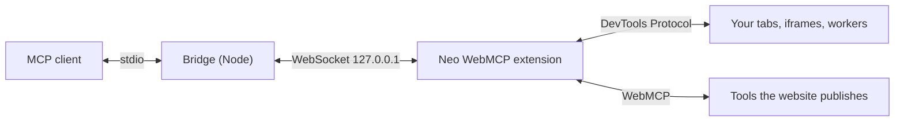

# Neo WebMCP

**Your real Chrome as an MCP server, with WebMCP built in.**

Neo WebMCP is an MCP server delivered as a Chrome extension. AI agents (Claude Code, Claude Desktop, Cursor, or any MCP client that speaks stdio) drive **the Chrome you already use**, with your logins and extensions: they operate pages like a person, watch and understand video, read everything DevTools sees, and, through **WebMCP**, call the tools that websites publish for agents.



## WebMCP, first class

[WebMCP](https://github.com/webmachinelearning/webmcp) is a proposed web standard (a draft report of the W3C Web Machine Learning Community Group) that lets a web page publish tools for AI agents, either from script with `document.modelContext.registerTool()` or declaratively with `<form toolname>`. Instead of guessing which buttons to click, the agent calls the site's own functions with typed input.

Neo WebMCP turns those page tools into MCP tools:

- **Auto-exposed to your agent.** Every WebMCP tool of the tab the agent is working on appears in the client's tool list as `site_<name>`, with the page's input schema. The page's read-only and consequential hints become the MCP `readOnlyHint` and `destructiveHint` annotations.
- **Always current.** The tool list is refreshed (`notifications/tools/list_changed`) when the page adds or removes tools, when it navigates away, and when the agent switches to another tab.
- **Works with any client.** Clients without dynamic tool lists use `webmcp_list` and `webmcp_call` instead.
- **Script and declarative tools, in every frame** of the page.
- **Safe by default.** Tool output is marked as untrusted content from the website, and the agent is told never to follow instructions found inside it.
- **For site builders.** `agent_readiness_audit` scores a page with Lighthouse's "Agentic Browsing" criteria (accessibility tree quality, layout stability, WebMCP tools and the quality of their descriptions and schemas, `llms.txt`). The `test_webmcp_tools` prompt exercises your tools and reviews their descriptions and schemas.

A page that publishes two tools:

```html
<script>
  document.modelContext?.registerTool({
    name: 'add_todo',
    description: 'Add a todo item to the visible list and return how many todos there are now.',
    inputSchema: { type: 'object', properties: { text: { type: 'string', description: 'The todo text' } }, required: ['text'] },
    execute: async ({ text }) => {
      /* update the page */
      return `Added "${text}".`;
    },
  });
</script>

<form toolname="search_products" tooldescription="Search the product catalog by keyword and return the matching product names." toolautosubmit>
  <input name="query" required toolparamdescription="Keyword to search for, case-insensitive" />
</form>
```

The agent then sees `site_add_todo` and `site_search_products` next to Neo WebMCP's own tools, and calls them like any other MCP tool.

**Enabling WebMCP:** it needs Chrome 149 or newer, either on a site enrolled in the WebMCP origin trial, or locally by turning on `chrome://flags/#enable-webmcp-testing` and restarting Chrome. When WebMCP is not available, `webmcp_list` explains how to enable it instead of returning an empty list.

## More features

- **Native browser control.** Tabs, navigation, an accessibility tree with stable refs (`e12`), click, type, drag, upload and dialogs with trusted mouse and keyboard events, through shadow DOM and cross-origin iframes, also on background tabs. Screenshots with Set-of-Mark labels. Downloads, history, bookmarks, clipboard, PDF.
- **Video understanding.** List videos, control playback, grab frames at any time (cross-origin videos included), build a storyboard grid, read captions (WebVTT, SRT, TTML, YouTube), and transcribe speech with Whisper **running on your machine** (audio never leaves it). `video_watch` returns a storyboard and the speech timeline in one call.
- **All of DevTools.** Console, Network (details, bodies, WebSocket frames, HAR, mocking and blocking), Core Web Vitals, Performance traces with analysis, Coverage, Elements (box model, CSS rules, event listeners), Application (cookies, storage, IndexedDB, Cache Storage, service workers), Issues, Memory (heap snapshots), Media, device, network and CPU emulation, and `cdp_send` for any DevTools Protocol command.
- **Two-way DevTools.** A "Neo MCP" panel inside DevTools: select an element or a request and send it to the agent with a note; the agent can reveal an element or a source line in your DevTools.
- **Many agents at once.** Each MCP client is its own session with its own colored tab group; sessions never mix.
- **You stay in control.** The agent works fully automatically, but a controlled tab shows a border and a **Stop** button, and the side panel offers Stop and Resume per session or for all, plus a live activity log.

The extension UI follows Chrome's language: English or Vietnamese (English by default).

## Requirements

- Desktop Chrome 125 or newer; tested on Chrome 155. WebMCP needs Chrome 149 or newer (see [WebMCP, first class](#webmcp-first-class)).
- Node.js 22.18 or newer.
- An MCP client that supports stdio servers.

## Installation

**1. Build**

```bash
npm install
npm run build
```

This produces the extension in `dist/extension/` and the bridge at `dist/bridge/cli.mjs`.

**2. Load the extension into Chrome**

Open `chrome://extensions`, turn on **Developer mode**, click **Load unpacked** and pick the `dist/extension` folder. Click the Neo WebMCP toolbar icon to open the side panel.

**3. Add it to your MCP client**

Claude Code:

```bash
claude mcp add neo-webmcp -- node "/path/to/neo-webmcp/dist/bridge/cli.mjs"
```

Clients configured with JSON (Claude Desktop, Cursor…):

```json
{
  "mcpServers": {
    "neo-webmcp": {
      "command": "node",
      "args": ["/path/to/neo-webmcp/dist/bridge/cli.mjs"]
    }
  }
}
```

After the first connection, the **Connect an MCP client** section of the side panel shows both snippets with the real path on your machine, which makes adding more clients easy.

**4. Check**

Start your MCP client: the side panel changes from *Waiting for an MCP client…* to *Connected sessions: 1* and lists the new session. Try asking the agent: *"Use browser_status, then take a screenshot of the current tab."*

The extension finds bridges on 127.0.0.1 ports 17831–17840. Each MCP client takes one port, so up to 10 clients can be connected at once.

## Full DevTools channel

Chrome lets extensions use only part of the DevTools Protocol. These features need the **full DevTools channel**: heap snapshots (`memory` action `snapshot`), JavaScript coverage, codec and decoder details like the Media panel, and `cdp_send` with the blocked domains (Profiler, HeapProfiler, Memory, Media, IndexedDB, ServiceWorker, Security, Animation, Preload…). Without the channel, these tools still return what they can, plus instructions for turning it on.

There are two ways to get it; pick one.

**Option A: a separate browser for the agent (never asks):**

```bash
node dist/bridge/cli.mjs chrome
```

This starts Chrome with its own profile in `~/.neo-webmcp/chrome-profile` and remote debugging turned on. Logins made in this profile are kept for next time. Options: `--chrome-path <exe>`, `--profile-dir <folder>`, `--url <address>`.

Branded Google Chrome ignores loading extensions from the command line. In that case the command prints what to do: in the window that opened, go to `chrome://extensions`, click **Load unpacked** and pick `dist/extension`. This is needed **once** per profile.

**Option B: your normal Chrome:**

Open `chrome://inspect/#remote-debugging` and turn remote debugging on. The first time the agent needs the full channel, Chrome asks for permission; click **Allow**. Neo WebMCP keeps a single connection shared by all agents, so this prompt appears **at most once per Chrome start**. Neo WebMCP never clicks that prompt for you.

The connection is held by a small background process (the "broker") that starts when needed and exits when Chrome closes. `browser_status` shows the state of the channel.

## Video and Whisper

- Captions are preferred when they exist (`<track>` elements, caption files downloaded by the player, YouTube). Otherwise speech is transcribed with Whisper running locally (Transformers.js, CPU).
- Pick the model in the side panel: `tiny` (fastest), `base` (default) or `small` (most accurate). The first use downloads the model from Hugging Face into `~/.cache/neo-webmcp/models` (about 76 MB for `base`); later runs use the saved copy.
- Audio source (`source`): the default `auto` tries, in order, decoding the media file directly when the video has a direct URL (cross-origin included); then capturing the playing element in real time (streams and MSE; you still hear it); then capturing the whole tab's audio if you allowed it by clicking the Neo WebMCP icon on that tab. If none works, the agent gets the reason for each attempt and how to grant access. The agent can also ask for `decode`, `stream` or `tab` directly. Silent segments are reported as silent instead of returning an empty transcript.

## Prompts

The server provides 5 MCP prompts (in Claude Code, type `/` to pick one):

| Prompt | Use it to |
|---|---|
| `debug_page` | Find why a page misbehaves using console, network, issues and the accessibility tree |
| `audit_performance` | Measure Web Vitals, record a trace, measure coverage and find what slows the page down |
| `watch_video` | Watch and summarize a video, or answer a question about it |
| `test_webmcp_tools` | Exercise the page's WebMCP tools and review their descriptions and schemas |
| `agent_readiness` | Score how well a page works for AI agents and how to improve it |

## Tools (56)

Each description is the first sentence of what the agent receives.

**WebMCP**

| Tool | Description |
|---|---|
| `webmcp_list` | Lists the tools the page exposes through WebMCP (W3C navigator/document.modelContext, imperative or declarative `<form toolname>`), in every frame: name, description, input schema and the readOnly / consequential / untrustedContent hints. |
| `webmcp_call` | Calls a WebMCP tool exposed by the page with the given input and returns its output. |
| `agent_readiness_audit` | Scores how ready the page is for AI agents, following Lighthouse's "Agentic Browsing" criteria: accessibility tree quality (named controls, labelled inputs, image alt text, landmarks, headings), layout stability (CLS), WebMCP tools and the quality of their descriptions/schemas, and llms.txt. |
| `site_*` | Created on the fly: one MCP tool per WebMCP tool of the current tab. |

**Connection**

| Tool | Description |
|---|---|
| `browser_status` | Reports whether the Neo WebMCP Chrome extension is connected to this bridge, the extension and browser versions, the bridge port, and whether the full DevTools channel is available. |

**Tabs and navigation**

| Tool | Description |
|---|---|
| `tabs_list` | Lists every open tab in every window with its id, title, URL, whether it is active/audible, its tab group, and which tab is this session's target. |
| `tab_open` | Opens a URL in a new tab, puts it in this session's tab group and makes it the session target tab. |
| `tab_select` | Makes a tab the default target for subsequent tools in this session, and optionally brings it to the front. |
| `tab_close` | Closes one or more tabs by id (from tabs_list). |
| `navigate` | Navigates the tab to a URL, or goes back/forward/reloads. |
| `wait_for` | Waits until text appears or disappears, a CSS selector matches a visible element, the network is idle, or a fixed time passes. |
| `page_info` | Returns URL, title, load state, language, viewport and scroll position, document size, the frame tree (including cross-origin iframes) and the main document's security details. |

**Reading the page**

| Tool | Description |
|---|---|
| `page_snapshot` | Returns the page as a compact accessibility tree (roles, names, states, values) built by Chrome itself, including cross-origin iframes and shadow DOM. |
| `page_read` | Returns the readable content of the page (or of one element) as Markdown: headings, paragraphs, lists, links, tables, code. |
| `find` | Finds elements by visible text, CSS selector, XPath, or accessible role/name (searches iframes and shadow DOM) and returns refs with role, name and position. |
| `screenshot` | Captures the viewport, the full page, or one element. With annotate=true, draws numbered boxes labelled with element refs over interactive elements (Set-of-Mark). |

**Acting on the page**

| Tool | Description |
|---|---|
| `click` | Clicks an element (by ref) or a viewport point with real, trusted mouse events. |
| `hover` | Moves the mouse over an element (by ref) or a viewport point, triggering hover menus and tooltips. |
| `type` | Types text into an element (by ref) or into the focused element like a person: one trusted key event per character (characters without a US key are committed as an IME would). |
| `press_key` | Presses a key or key combination on the focused element, e.g. "Enter", "Escape", "Control+A", "Shift+Tab", "ArrowDown". |
| `fill_form` | Fills several form fields in one call. |
| `select_option` | Selects one or more options of a `<select>` element by visible label or value. |
| `scroll` | Scrolls an element into view (ref), or scrolls the page or the element under a point by a direction/amount using real mouse-wheel events (with script in a background tab, where Chrome ignores wheel events). |
| `drag` | Drags from one element or point to another with real mouse events; supports both mouse-driven and HTML5 drag-and-drop. |
| `upload_file` | Attaches local files (absolute paths on this machine) to a file input element. |
| `dialog` | Accepts or dismisses the JavaScript dialog (alert, confirm, prompt, beforeunload) currently open in the tab. |
| `evaluate` | Runs JavaScript in the page and returns the result as JSON. |

**Browser utilities**

| Tool | Description |
|---|---|
| `downloads` | Manages browser downloads: "download" starts downloading a URL, "list" shows recent downloads, "wait" waits for a download to finish, "cancel" cancels one. |
| `history_search` | Searches the browsing history by text and time range. |
| `bookmarks` | Searches the user's bookmarks by title/URL, creates a bookmark (or folder), or removes one by id. |
| `clipboard` | Reads or writes the system clipboard as plain text. |
| `pdf_save` | Prints the page to a PDF file and returns its path. |

**Video**

| Tool | Description |
|---|---|
| `video_list` | Lists every `<video>`/`<audio>` element on the page, including iframes and shadow DOM: ref, source, duration, position, playing/paused, volume, rate, resolution, live stream or not, DRM, caption tracks, and the detected platform (YouTube, Vimeo…). |
| `video_control` | Plays, pauses, seeks, changes rate, mutes/unmutes or sets the volume of a video. |
| `video_frame` | Returns frames of a video as images: the current frame, or frames at given times. |
| `video_storyboard` | Samples N frames evenly across a time range and returns them as ONE grid image, each tile stamped with its timestamp, so you can see a whole stretch of video at once. |
| `video_captions` | Returns the captions/subtitles of a video with timestamps. |
| `video_transcribe` | Transcribes the speech of a video segment with Whisper running locally on this machine (audio never leaves it). |
| `video_watch` | The fastest way to understand a video: in one call returns video info, a storyboard of the segment, and its speech as a timeline (captions when available, otherwise local Whisper transcription), stating which source was used. |
| `media_inspect` | Player details like the DevTools Media panel: resolution, frame rate, dropped frames, buffered ranges, ready/network state, errors and recent events; codec and bitrate when they can be determined. |

**DevTools**

| Tool | Description |
|---|---|
| `console_logs` | Reads the tab's console like the DevTools Console panel: console.* calls, uncaught exceptions and promise rejections (with stack traces), and browser-side messages (network errors, violations, deprecations) — from the page and its iframes/workers. |
| `network_requests` | Lists the tab's requests like the DevTools Network panel: id, method, URL, status, type, size, duration, cache, initiator. |
| `network_request` | Full details of one request: request/response headers, request body, response body (text, or saved to a file when binary/large), timing breakdown, security details, initiator stack and WebSocket frames. |
| `network_har` | Exports the captured requests of the tab as a HAR 1.2 file (optionally with response bodies) and returns its path. |
| `network_mock` | Adds, lists or removes interception rules for the tab: block matching requests, answer them with a fake response, or rewrite request headers. |
| `perf_metrics` | Measures Core Web Vitals of the current page (LCP with its element, CLS with the shifting elements, INP, FCP, TTFB) and runtime metrics (JS heap, DOM nodes, layouts, style recalcs, script time). |
| `perf_trace` | Records a performance trace like the DevTools Performance panel (optionally reloading the page first), saves the .json trace (open it in DevTools > Performance) and returns an analysis: long tasks, total blocking time, main-thread breakdown, render-blocking requests, LCP, CLS and the slowest scripts. |
| `coverage` | Measures unused CSS and JavaScript per file like the DevTools Coverage panel. |
| `dom_inspect` | Inspects one element like the DevTools Elements panel: outer HTML, attributes, box model, computed styles, matched CSS rules with their stylesheet and line, inherited styles, event listeners, and accessibility properties. |
| `storage` | Reads and edits application data like the DevTools Application panel: cookies (incl. HttpOnly), local/session storage, IndexedDB, Cache Storage, service workers, manifest, quota. |
| `emulate` | Emulates a device (preset or custom viewport), user agent, locale, timezone, geolocation, dark/light mode, reduced motion, network conditions, CPU slowdown or a vision deficiency. |
| `devtools_issues` | Lists the problems the DevTools Issues panel detected on the page: CORS, mixed content, cookie and SameSite problems, Content Security Policy violations, deprecated APIs, quirks mode, heavy ads and more. |
| `memory` | "counters": JS heap size, DOM nodes, documents, frames and event listeners. "snapshot": takes a heap snapshot like the DevTools Memory panel and summarizes the biggest object classes and detached DOM nodes (needs the full DevTools channel). |
| `cdp_send` | Sends any Chrome DevTools Protocol command to the tab (or to an iframe via frame ref, or a child session id) and returns the raw result. |
| `cdp_events` | Subscribes to raw DevTools Protocol events of the tab ("Network.*", "Page.loadEventFired"…) and reads the buffered events. |

**Two-way DevTools**

| Tool | Description |
|---|---|
| `devtools_context` | When the user has DevTools open on the tab: returns the element currently selected in the Elements panel (selector, HTML, ref) and the items the user sent to the agent from the "Neo MCP" DevTools panel (elements or network requests with notes). |
| `devtools_reveal` | Shows something to the user in their open DevTools: an element in the Elements panel (ref or selector), or a source file at a line in the Sources panel (url + line). |

Every tool that acts on a tab accepts an optional `tabId`; by default it uses the session's target tab (the tab you are looking at, or the tab the agent opened or selected).

## Safety and privacy

- The agent works **fully automatically**, on any tab, without asking before each action. Only connect MCP clients you trust.
- A controlled tab shows a purple border and a "… is controlling this tab" label with a **Stop** button; the side panel has **Stop all** / **Resume all** and Stop / Resume per session. Stop cancels the running command and pauses the session (the border turns amber) until you click Resume. The border can be turned off in the side panel settings.
- The bridge listens on 127.0.0.1 only and accepts connections from the Neo WebMCP extension only.
- Audio for transcription is processed by Whisper on your machine and is not sent anywhere.
- The activity log hides the values of arguments whose names contain password, secret, token, otp, pin, cvv or card. The log is kept for the Chrome session (not written to disk) and is cleared when Chrome closes.
- Content that comes from web pages (WebMCP tool results included) is marked as untrusted, and the agent is told never to follow instructions found in it.
- When a session ends, Neo WebMCP removes its debugger, emulation, network mocks and border from the tabs, without closing any tab.
- `chrome://` pages and the Chrome Web Store are protected by Chrome; the extension cannot control them.

## Configuration

Bridge command line:

| Command | Meaning |
|---|---|
| `neo-webmcp [--port <n>] [--output-dir <folder>]` | Runs the bridge on stdio (what MCP clients start) |
| `neo-webmcp chrome [--chrome-path <exe>] [--profile-dir <folder>] [--url <address>]` | Starts Chrome with a dedicated agent profile (full DevTools channel, no prompts) |
| `neo-webmcp --help` / `--version` | Help / version |

`neo-webmcp` above is the same as `node dist/bridge/cli.mjs`.

Environment variables:

| Variable | Default | Meaning |
|---|---|---|
| `NEO_WEBMCP_OUTPUT_DIR` | `~/.neo-webmcp/output` | Where screenshots, PDFs, HAR files, traces and heap snapshots go when no path is given |
| `NEO_WEBMCP_MODEL_DIR` | `~/.cache/neo-webmcp/models` | Where Whisper models are stored |
| `NEO_WEBMCP_CDP_ENDPOINT` | — | A specific remote debugging endpoint (`ws://…`) for the full DevTools channel |
| `NEO_WEBMCP_CHROME_USER_DATA_DIR` | — | A Chrome profile folder to look for a remote debugging endpoint in |
| `NEO_WEBMCP_STATE_DIR` | `~/.neo-webmcp` | Where the broker writes its connection info |
| `NEO_WEBMCP_NO_DEFAULT_PROFILES` | — | `1` = never look at normal Chrome profiles (used by the tests) |

## Development and testing

```bash
npm run build        # build the extension and the bridge into dist/
npm run typecheck    # TypeScript type check
npm run test:unit    # pure logic tests
npm run test:e2e     # build the test build into dist-test/, then run end-to-end tests with a real Chrome
npm test             # build + unit + e2e
```

End-to-end tests use Chrome for Testing 155 with temporary profiles and never touch your Chrome, your Downloads folder or your clipboard. The test build (`dist-test/`) is identical to the real one except that its bridge uses ports 17931–17940, so even while your own Chrome runs Neo WebMCP and your MCP client is open, the tests and your real setup never connect to each other. Install the test browser once:

```bash
npx @puppeteer/browsers install chrome@155.0.8059.41 --path .cache/chrome
```

On macOS/Linux, or to test with another Chrome, set `NEO_TEST_CHROME` to the Chrome executable. The `devtools-panel` suite opens a visible Chrome window (extension DevTools panels do not run headless). Test files go to `tests/.artifacts/`.

Code structure and the rules for adding features: [architecture.md](architecture.md). Feature requirements: [brd.md](brd.md). Both are written in Vietnamese.

## Known limitations

- Some DevTools data is only available through the full DevTools channel (see above).
- DRM-protected video: Chrome does not let anyone read encrypted frames directly, so frames are captured from what the page shows; if the player also protects what is shown (it renders black), the tool says the frame is blocked by DRM instead of returning a black image as a normal result.
- Cross-origin video without CORS is captured from what the page shows rather than decoded, so the video element must be rendered.
- Background target tab (you are looking at another tab): everything still works without bringing the tab to the front, but `hover` and mouse-driven drags are slower (about 5 seconds per mouse move, because Chrome delivers mouse moves to hidden tabs only after a delay), and scrolling by an amount is done with script because Chrome ignores the mouse wheel in hidden tabs.
- Capturing a whole tab's audio needs you to click the Neo WebMCP icon on that tab first (a Chrome rule). The tests stand in for that click with Chromium's `--allowlisted-extension-id` switch.
- Tabs you opened before the agent touched them: requests and console messages from their earlier load are not available (like opening DevTools after a page has loaded); the tools remind the agent to reload when needed. Tabs the agent opens with `tab_open` are recorded from the start.
- WebMCP is still an experimental Chrome feature and needs a flag (or a site in the origin trial).
