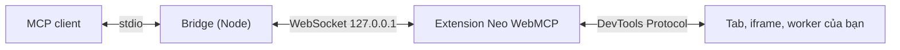

# Neo WebMCP

MCP server chạy dưới dạng extension Chrome. Agent AI (Claude Code, Claude Desktop, Cursor… hoặc bất kỳ MCP client nào dùng stdio) điều khiển **chính Chrome bạn đang dùng**: thao tác mọi thứ như người thật, xem và hiểu video, đọc toàn bộ dữ liệu DevTools, và gọi các tool WebMCP mà website tự công bố.



## Tính năng chính

- **Điều khiển trình duyệt native** — tab, điều hướng, cây accessibility có ref ổn định (`e12`), click/gõ/kéo thả/upload/dialog bằng sự kiện chuột-phím tin cậy, xuyên shadow DOM và iframe khác origin; ảnh chụp có đánh nhãn Set-of-Mark; tải xuống, lịch sử, bookmark, clipboard, PDF.
- **Xem và hiểu video** — liệt kê video, điều khiển phát, lấy khung hình tại thời điểm bất kỳ (kể cả video khác origin), storyboard dạng lưới, phụ đề (WebVTT, SRT, TTML, YouTube), phiên âm bằng Whisper **chạy ngay trên máy** (audio không rời máy), `video_watch` trả storyboard + lời thoại trong một lần gọi.
- **Đọc mọi dữ liệu DevTools** — Console, Network (chi tiết, body, WebSocket, HAR, mock/chặn), Core Web Vitals, Performance trace có phân tích, Coverage, Elements (box model, CSS rule, event listener), Application (cookie, storage, IndexedDB, Cache, service worker), Issues, Memory (heap snapshot), Media, giả lập thiết bị/mạng/CPU, và `cdp_send` cho mọi lệnh DevTools Protocol.
- **DevTools hai chiều** — panel "Neo MCP" trong DevTools: bạn chọn phần tử hoặc request rồi "Gửi cho agent" kèm ghi chú; agent có thể mở phần tử/file nguồn cho bạn xem.
- **WebMCP** — đọc và gọi tool trang web công bố qua `document.modelContext` hoặc `<form toolname>`; tool của trang tự xuất hiện thành tool MCP `site_*`; chấm điểm mức sẵn sàng cho agent.
- **Nhiều agent cùng lúc** — mỗi MCP client là một phiên riêng với nhóm tab màu riêng; các phiên không lẫn nhau.
- **Bạn luôn nắm quyền** — agent tự động hoàn toàn, nhưng tab đang bị điều khiển có viền báo hiệu và nút **Dừng**; side panel có Dừng/Tiếp tục từng phiên hoặc tất cả, và nhật ký hoạt động.

Giao diện theo ngôn ngữ Chrome: tiếng Việt hoặc tiếng Anh (mặc định tiếng Anh).

## Yêu cầu

- Chrome (desktop) 125 trở lên; đã kiểm thử trên Chrome 155. WebMCP cần Chrome 149+ (xem [WebMCP](#webmcp)).
- Node.js 22.18 trở lên.
- Một MCP client hỗ trợ server stdio.

## Cài đặt

**1. Build**

```bash
npm install
npm run build
```

Kết quả: extension ở `dist/extension/`, bridge ở `dist/bridge/cli.mjs`.

**2. Nạp extension vào Chrome**

Mở `chrome://extensions`, bật **Developer mode**, bấm **Load unpacked** và chọn thư mục `dist/extension`. Bấm biểu tượng Neo WebMCP trên thanh công cụ để mở side panel.

**3. Thêm vào MCP client**

Claude Code:

```bash
claude mcp add neo-webmcp -- node "/đường/dẫn/tới/neo-webmcp/dist/bridge/cli.mjs"
```

Client dùng file cấu hình JSON (Claude Desktop, Cursor…):

```json
{
  "mcpServers": {
    "neo-webmcp": {
      "command": "node",
      "args": ["/đường/dẫn/tới/neo-webmcp/dist/bridge/cli.mjs"]
    }
  }
}
```

Sau lần kết nối đầu tiên, mục **Kết nối MCP client** (*Connect an MCP client*) trong side panel hiện sẵn hai đoạn trên với đường dẫn thật trên máy bạn, tiện thêm client khác.

**4. Kiểm tra**

Khởi động MCP client: side panel đổi từ *Đang chờ MCP client…* sang *Phiên đang kết nối: 1* và phiên mới hiện trong danh sách. Thử hỏi agent: *"Dùng browser_status rồi chụp màn hình tab hiện tại"*.

Extension tự tìm bridge trên cổng 127.0.0.1:17831–17840; mỗi MCP client chiếm một cổng, nên tối đa 10 client cùng lúc.

## Kênh DevTools đầy đủ

Chrome chỉ cho extension dùng một phần DevTools Protocol. Các tính năng sau cần **kênh DevTools đầy đủ**: heap snapshot (`memory` action `snapshot`), JavaScript coverage, thông tin codec/decoder kiểu panel Media, và `cdp_send` với các domain bị chặn (Profiler, HeapProfiler, Memory, Media, IndexedDB, ServiceWorker, Security, Animation, Preload…). Khi chưa có kênh này, các tool đó vẫn trả phần lấy được và kèm hướng dẫn bật.

Có hai cách, chọn một:

**Cách A — trình duyệt riêng cho agent (không bao giờ hỏi):**

```bash
node dist/bridge/cli.mjs chrome
```

Lệnh mở Chrome với profile riêng ở `~/.neo-webmcp/chrome-profile` và bật remote debugging. Đăng nhập trong profile này được giữ lại cho lần sau. Tùy chọn: `--chrome-path <exe>`, `--profile-dir <thư mục>`, `--url <địa chỉ>`.

Chrome bản thương hiệu (Google Chrome) bỏ qua việc tự nạp extension qua dòng lệnh; khi đó lệnh in ra hướng dẫn: trong cửa sổ vừa mở, vào `chrome://extensions` → **Load unpacked** → chọn `dist/extension`. Chỉ cần làm **một lần** cho profile này.

**Cách B — Chrome thường của bạn:**

Mở `chrome://inspect/#remote-debugging` và bật remote debugging. Lần đầu agent cần kênh đầy đủ, Chrome hỏi cho phép — bấm **Allow**. Neo WebMCP giữ một kết nối duy nhất dùng chung cho mọi agent, nên hộp thoại này hiện **tối đa một lần mỗi lần mở Chrome**. Neo WebMCP không bao giờ tự bấm hộp thoại đó thay bạn.

Kết nối do một tiến trình nền nhỏ ("broker") giữ, tự khởi động khi cần và tự thoát khi Chrome đóng. `browser_status` cho biết kênh đang ở trạng thái nào.

## WebMCP

WebMCP là chuẩn W3C (đang thử nghiệm) cho phép trang web tự công bố tool cho agent. Trên Chrome 149+, bật `chrome://flags/#enable-webmcp-testing` rồi khởi động lại Chrome (hoặc dùng site thuộc origin trial).

- `webmcp_list` liệt kê tool của trang (mọi frame), kèm gợi ý readOnly / consequential / untrustedContent.
- `webmcp_call` gọi tool; kết quả luôn được đánh dấu là dữ liệu không tin cậy.
- Tool của tab đích tự xuất hiện trong danh sách tool MCP với tiền tố `site_` (ví dụ `site_add_todo`) và client được thông báo khi danh sách đổi; rời trang thì các tool đó biến mất.
- `agent_readiness_audit` chấm điểm trang theo tiêu chí "Agentic Browsing" của Lighthouse: chất lượng cây accessibility, độ ổn định layout, tool WebMCP, `llms.txt`.

## Video và Whisper

- Phụ đề được ưu tiên khi có (thẻ `<track>`, phụ đề tải qua mạng, YouTube). Không có thì phiên âm bằng Whisper chạy cục bộ (Transformers.js, CPU).
- Chọn model trong side panel: `tiny` (nhanh nhất), `base` (mặc định), `small` (chính xác nhất). Lần dùng đầu tiên tải model từ Hugging Face về `~/.cache/neo-webmcp/models` (model `base` khoảng 76 MB); các lần sau dùng bản đã lưu.
- Nguồn âm thanh (`source`): mặc định `auto` thử lần lượt — giải mã thẳng file media khi video có URL trực tiếp (kể cả khác origin); không được thì thu luồng từ phần tử đang phát theo thời gian thực (stream/MSE; bạn vẫn nghe bình thường); vẫn không được thì thu âm thanh cả tab nếu bạn đã cấp quyền bằng cách bấm biểu tượng Neo WebMCP trên tab đó. Hết cách thì agent nhận lý do của từng cách và hướng dẫn cấp quyền. Agent cũng có thể chỉ định thẳng `decode`, `stream` hoặc `tab`. Đoạn im lặng được báo là im lặng thay vì trả bản phiên âm rỗng.

## Prompt mẫu

Server cung cấp 5 prompt MCP (trong Claude Code gõ `/` để chọn):

| Prompt | Dùng để |
|---|---|
| `debug_page` | Tìm nguyên nhân trang lỗi qua console, network, issues và cây accessibility |
| `audit_performance` | Đo Web Vitals, ghi trace, đo coverage, tìm nguyên nhân chậm |
| `watch_video` | Xem và tóm tắt video, trả lời câu hỏi về nội dung |
| `test_webmcp_tools` | Thử các tool WebMCP của trang và nhận xét chất lượng mô tả/schema |
| `agent_readiness` | Đánh giá mức sẵn sàng cho agent và cách cải thiện |

## Danh sách tool (56)

Mô tả dưới đây là câu đầu trong mô tả mà agent nhận được.

**Kết nối**

| Tool | Mô tả |
|---|---|
| `browser_status` | Reports whether the Neo WebMCP Chrome extension is connected to this bridge, the extension and browser versions, the bridge port, and whether the full DevTools channel is available. |

**Tab & điều hướng**

| Tool | Mô tả |
|---|---|
| `tabs_list` | Lists every open tab in every window with its id, title, URL, whether it is active/audible, its tab group, and which tab is this session's target. |
| `tab_open` | Opens a URL in a new tab, puts it in this session's tab group and makes it the session target tab. |
| `tab_select` | Makes a tab the default target for subsequent tools in this session, and optionally brings it to the front. |
| `tab_close` | Closes one or more tabs by id (from tabs_list). |
| `navigate` | Navigates the tab to a URL, or goes back/forward/reloads. |
| `wait_for` | Waits until text appears or disappears, a CSS selector matches a visible element, the network is idle, or a fixed time passes. |
| `page_info` | Returns URL, title, load state, language, viewport and scroll position, document size, the frame tree (including cross-origin iframes) and the main document's security details. |

**Đọc hiểu trang**

| Tool | Mô tả |
|---|---|
| `page_snapshot` | Returns the page as a compact accessibility tree (roles, names, states, values) built by Chrome itself, including cross-origin iframes and shadow DOM. |
| `page_read` | Returns the readable content of the page (or of one element) as Markdown: headings, paragraphs, lists, links, tables, code. |
| `find` | Finds elements by visible text, CSS selector, XPath, or accessible role/name (searches iframes and shadow DOM) and returns refs with role, name and position. |
| `screenshot` | Captures the viewport, the full page, or one element. With annotate=true, draws numbered boxes labelled with element refs over interactive elements (Set-of-Mark). |

**Thao tác**

| Tool | Mô tả |
|---|---|
| `click` | Clicks an element (by ref) or a viewport point with real, trusted mouse events. |
| `hover` | Moves the mouse over an element (by ref) or a viewport point, triggering hover menus and tooltips. |
| `type` | Types text into an element (by ref) or into the focused element like a person: one trusted key event per character (characters without a US key are committed as an IME would). |
| `press_key` | Presses a key or key combination on the focused element, e.g. "Enter", "Escape", "Control+A", "Shift+Tab", "ArrowDown". |
| `fill_form` | Fills several form fields in one call. |
| `select_option` | Selects one or more options of a `<select>` element by visible label or value. |
| `scroll` | Scrolls an element into view (ref), or scrolls the page or the element under a point by a direction/amount using real mouse-wheel events (with script in a background tab, where Chrome ignores wheel events). |
| `drag` | Drags from one element or point to another with real mouse events; supports both mouse-driven and HTML5 drag-and-drop. |
| `upload_file` | Attaches local files (absolute paths on this machine) to a file input element. |
| `dialog` | Accepts or dismisses the JavaScript dialog (alert, confirm, prompt, beforeunload) currently open in the tab. |
| `evaluate` | Runs JavaScript in the page and returns the result as JSON. |

**Tiện ích trình duyệt**

| Tool | Mô tả |
|---|---|
| `downloads` | Manages browser downloads: "download" starts downloading a URL, "list" shows recent downloads, "wait" waits for a download to finish, "cancel" cancels one. |
| `history_search` | Searches the browsing history by text and time range. |
| `bookmarks` | Searches the user's bookmarks by title/URL, creates a bookmark (or folder), or removes one by id. |
| `clipboard` | Reads or writes the system clipboard as plain text. |
| `pdf_save` | Prints the page to a PDF file and returns its path. |

**Video**

| Tool | Mô tả |
|---|---|
| `video_list` | Lists every `<video>`/`<audio>` element on the page, including iframes and shadow DOM: ref, source, duration, position, playing/paused, volume, rate, resolution, live stream or not, DRM, caption tracks, and the detected platform (YouTube, Vimeo…). |
| `video_control` | Plays, pauses, seeks, changes rate, mutes/unmutes or sets the volume of a video. |
| `video_frame` | Returns frames of a video as images: the current frame, or frames at given times. |
| `video_storyboard` | Samples N frames evenly across a time range and returns them as ONE grid image, each tile stamped with its timestamp, so you can see a whole stretch of video at once. |
| `video_captions` | Returns the captions/subtitles of a video with timestamps. |
| `video_transcribe` | Transcribes the speech of a video segment with Whisper running locally on this machine (audio never leaves it). |
| `video_watch` | The fastest way to understand a video: in one call returns video info, a storyboard of the segment, and its speech as a timeline (captions when available, otherwise local Whisper transcription), stating which source was used. |
| `media_inspect` | Player details like the DevTools Media panel: resolution, frame rate, dropped frames, buffered ranges, ready/network state, errors and recent events; codec and bitrate when they can be determined. |

**DevTools**

| Tool | Mô tả |
|---|---|
| `console_logs` | Reads the tab's console like the DevTools Console panel: console.* calls, uncaught exceptions and promise rejections (with stack traces), and browser-side messages (network errors, violations, deprecations) — from the page and its iframes/workers. |
| `network_requests` | Lists the tab's requests like the DevTools Network panel: id, method, URL, status, type, size, duration, cache, initiator. |
| `network_request` | Full details of one request: request/response headers, request body, response body (text, or saved to a file when binary/large), timing breakdown, security details, initiator stack and WebSocket frames. |
| `network_har` | Exports the captured requests of the tab as a HAR 1.2 file (optionally with response bodies) and returns its path. |
| `network_mock` | Adds, lists or removes interception rules for the tab: block matching requests, answer them with a fake response, or rewrite request headers. |
| `perf_metrics` | Measures Core Web Vitals of the current page (LCP with its element, CLS with the shifting elements, INP, FCP, TTFB) and runtime metrics (JS heap, DOM nodes, layouts, style recalcs, script time). |
| `perf_trace` | Records a performance trace like the DevTools Performance panel (optionally reloading the page first), saves the .json trace (open it in DevTools > Performance) and returns an analysis: long tasks, total blocking time, main-thread breakdown, render-blocking requests, LCP, CLS and the slowest scripts. |
| `coverage` | Measures unused CSS and JavaScript per file like the DevTools Coverage panel. |
| `dom_inspect` | Inspects one element like the DevTools Elements panel: outer HTML, attributes, box model, computed styles, matched CSS rules with their stylesheet and line, inherited styles, event listeners, and accessibility properties. |
| `storage` | Reads and edits application data like the DevTools Application panel: cookies (incl. HttpOnly), local/session storage, IndexedDB, Cache Storage, service workers, manifest, quota. |
| `emulate` | Emulates a device (preset or custom viewport), user agent, locale, timezone, geolocation, dark/light mode, reduced motion, network conditions, CPU slowdown or a vision deficiency. |
| `devtools_issues` | Lists the problems the DevTools Issues panel detected on the page: CORS, mixed content, cookie and SameSite problems, Content Security Policy violations, deprecated APIs, quirks mode, heavy ads and more. |
| `memory` | "counters": JS heap size, DOM nodes, documents, frames and event listeners. "snapshot": takes a heap snapshot like the DevTools Memory panel and summarizes the biggest object classes and detached DOM nodes (needs the full DevTools channel). |
| `cdp_send` | Sends any Chrome DevTools Protocol command to the tab (or to an iframe via frame ref, or a child session id) and returns the raw result. |
| `cdp_events` | Subscribes to raw DevTools Protocol events of the tab ("Network.*", "Page.loadEventFired"…) and reads the buffered events. |

**DevTools hai chiều**

| Tool | Mô tả |
|---|---|
| `devtools_context` | When the user has DevTools open on the tab: returns the element currently selected in the Elements panel (selector, HTML, ref) and the items the user sent to the agent from the "Neo MCP" DevTools panel (elements or network requests with notes). |
| `devtools_reveal` | Shows something to the user in their open DevTools: an element in the Elements panel (ref or selector), or a source file at a line in the Sources panel (url + line). |

**WebMCP**

| Tool | Mô tả |
|---|---|
| `webmcp_list` | Lists the tools the page exposes through WebMCP (W3C navigator/document.modelContext, imperative or declarative `<form toolname>`), in every frame: name, description, input schema and the readOnly / consequential / untrustedContent hints. |
| `webmcp_call` | Calls a WebMCP tool exposed by the page with the given input and returns its output. |
| `agent_readiness_audit` | Scores how ready the page is for AI agents, following Lighthouse's "Agentic Browsing" criteria: accessibility tree quality (named controls, labelled inputs, image alt text, landmarks, headings), layout stability (CLS), WebMCP tools and the quality of their descriptions/schemas, and llms.txt. |

Mọi tool tác động lên tab đều nhận `tabId` tùy chọn; mặc định là tab đích của phiên (tab bạn đang xem, hoặc tab agent đã mở/chọn).

## An toàn và quyền riêng tư

- Agent điều khiển **tự động hoàn toàn**, không hỏi từng thao tác, trên mọi tab. Chỉ kết nối MCP client bạn tin tưởng.
- Tab đang bị điều khiển có viền tím và nhãn "… đang điều khiển tab này" với nút **Dừng** (*Stop*); side panel có **Dừng tất cả** / **Tiếp tục tất cả** và Dừng/Tiếp tục từng phiên. Dừng hủy lệnh đang chạy và tạm dừng phiên (viền chuyển màu hổ phách) cho tới khi bạn bấm Tiếp tục. Có thể tắt viền trong phần cài đặt của side panel.
- Bridge chỉ nghe trên 127.0.0.1 và chỉ nhận kết nối từ đúng extension Neo WebMCP.
- Âm thanh để phiên âm được xử lý bằng Whisper trên máy bạn, không gửi đi đâu.
- Nhật ký hoạt động che giá trị của các tham số có tên chứa password, secret, token, otp, pin, cvv, card. Nhật ký được giữ trong phiên Chrome (không ghi ra đĩa) và mất khi đóng Chrome.
- Nội dung đến từ trang web (kể cả kết quả tool WebMCP) được đánh dấu là không tin cậy; agent được dặn không làm theo chỉ dẫn nằm trong đó.
- Phiên kết thúc thì Neo WebMCP gỡ debugger, giả lập, mock mạng và viền báo hiệu khỏi các tab, nhưng không đóng tab nào.
- Trang `chrome://` và Chrome Web Store được Chrome bảo vệ; extension không điều khiển được.

## Cấu hình

Tham số dòng lệnh của bridge:

| Lệnh | Ý nghĩa |
|---|---|
| `neo-webmcp [--port <n>] [--output-dir <thư mục>]` | Chạy bridge trên stdio (MCP client gọi lệnh này) |
| `neo-webmcp chrome [--chrome-path <exe>] [--profile-dir <thư mục>] [--url <địa chỉ>]` | Mở Chrome profile riêng cho agent (kênh DevTools đầy đủ, không hỏi) |
| `neo-webmcp --help` / `--version` | Trợ giúp / phiên bản |

`neo-webmcp` ở trên tương đương `node dist/bridge/cli.mjs`.

Biến môi trường:

| Biến | Mặc định | Ý nghĩa |
|---|---|---|
| `NEO_WEBMCP_OUTPUT_DIR` | `~/.neo-webmcp/output` | Nơi lưu ảnh, PDF, HAR, trace, heap snapshot khi không chỉ định đường dẫn |
| `NEO_WEBMCP_MODEL_DIR` | `~/.cache/neo-webmcp/models` | Nơi lưu model Whisper |
| `NEO_WEBMCP_CDP_ENDPOINT` | — | Endpoint remote debugging cụ thể (`ws://…`) cho kênh DevTools đầy đủ |
| `NEO_WEBMCP_CHROME_USER_DATA_DIR` | — | Thư mục profile Chrome cần tìm endpoint remote debugging |
| `NEO_WEBMCP_STATE_DIR` | `~/.neo-webmcp` | Nơi broker ghi thông tin kết nối |
| `NEO_WEBMCP_NO_DEFAULT_PROFILES` | — | `1` = không bao giờ dò profile Chrome thường (dùng khi chạy test) |

## Phát triển và kiểm thử

```bash
npm run build        # build extension + bridge vào dist/
npm run typecheck    # kiểm kiểu TypeScript
npm run test:unit    # test logic thuần
npm run test:e2e     # build bản test vào dist-test/ rồi chạy test đầu-cuối với Chrome thật
npm test             # build + unit + e2e
```

Test e2e dùng Chrome for Testing 155 với profile tạm, không đụng tới Chrome, thư mục Downloads hay clipboard của bạn. Bản test (`dist-test/`) giống hệt bản thật nhưng bridge dùng cổng 17931–17940, nên kể cả khi Chrome của bạn đang chạy Neo WebMCP và MCP client của bạn đang mở, test và bản thật không bao giờ kết nối nhầm sang nhau. Cài trình duyệt test một lần:

```bash
npx @puppeteer/browsers install chrome@155.0.8059.41 --path .cache/chrome
```

Trên macOS/Linux, hoặc để chạy với Chrome khác, đặt `NEO_TEST_CHROME` trỏ tới file chạy Chrome. Bộ `devtools-panel` mở cửa sổ Chrome thật (panel DevTools của extension không chạy được ở chế độ headless). File tạm của test nằm trong `tests/.artifacts/`.

Cấu trúc code và luật thêm tính năng: xem [architecture.md](architecture.md). Yêu cầu tính năng: xem [brd.md](brd.md).

## Giới hạn đã biết

- Một số dữ liệu DevTools chỉ có qua kênh DevTools đầy đủ (xem trên).
- Video có DRM: Chrome không cho đọc khung hình mã hóa trực tiếp, nên tool chụp từ hình hiển thị trên trang; nếu trình phát bảo vệ luôn cả hình hiển thị (ra màu đen), tool báo rõ khung hình bị DRM chặn thay vì trả ảnh đen như kết quả bình thường.
- Video khác origin không có CORS được chụp từ hình hiển thị trên trang thay vì giải mã khung hình, nên phần tử video phải đang được render.
- Tab đích ở nền (bạn đang xem tab khác): mọi thao tác vẫn chạy mà không đưa tab lên trước, nhưng `hover` và kéo thả bằng chuột chậm hơn (khoảng 5 giây mỗi lần di chuột, do Chrome chỉ giao sự kiện di chuột cho tab ẩn sau một khoảng chờ), còn cuộn theo khoảng cách được làm bằng script vì Chrome bỏ qua con lăn ở tab ẩn.
- Thu âm thanh cả tab cần bạn bấm biểu tượng Neo WebMCP trên tab đó trước (quy định của Chrome). Bộ test thay cú bấm đó bằng cờ `--allowlisted-extension-id` của Chromium.
- Tab bạn tự mở trước khi agent đụng tới: request/console của lần tải trước đó không có (giống mở DevTools sau khi trang đã tải); các tool nhắc agent tải lại khi cần. Tab do agent mở bằng `tab_open` thì được ghi từ đầu.
- WebMCP còn là tính năng thử nghiệm của Chrome và cần bật cờ.
