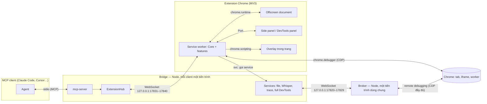
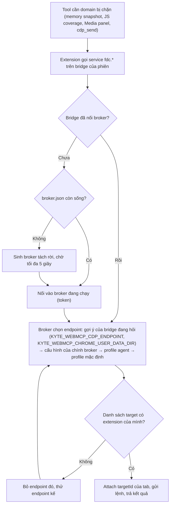

# Kiến trúc Kyte WebMCP Extension

Tài liệu này mô tả cách code được tổ chức và các luật phải giữ khi sửa hoặc thêm module. Yêu cầu tính năng nằm ở `brd.md` (nguồn sự thật duy nhất về hành vi); file này chỉ nói *code đặt ở đâu và nối với nhau thế nào*.

## 1. Các tiến trình và đường nối

Kyte WebMCP chạy trong năm môi trường. Mỗi môi trường có một "core" riêng; tính năng (feature) cắm vào core qua registry.



| Môi trường | Thư mục | Vai trò |
|---|---|---|
| Bridge (Node, stdio) | `src/bridge/` | MCP server cho client; mở WebSocket chờ extension; chạy service cần Node (ghi file, Whisper, phân tích trace, kênh DevTools đầy đủ). |
| Service worker | `src/extension/background/` | Core của extension: điều phối lời gọi tool, giữ phiên CDP, quản lý phiên agent, overlay, UI hub. |
| Offscreen document | `src/extension/offscreen/` | Những việc cần `document`: clipboard, giải mã audio (`decodeAudioData`), ghi audio tab. |
| UI | `src/extension/sidepanel/`, `src/extension/devtools/` | Side panel (trạng thái, phiên, nhật ký, cài đặt) và panel "Kyte WebMCP" trong DevTools. |
| Trong trang | `src/extension/content/overlay.ts` + các `page.ts` của feature | Overlay báo hiệu agent đang điều khiển; hàm chạy trong isolated world của trang. |
| Broker (Node, detached) | `src/features/full-devtools/broker.ts` | Giữ **một** kết nối remote-debugging tới Chrome, chia sẻ cho mọi bridge. |

## 2. Kiến trúc feature-based, fork-isolated

### 2.1 Luật

1. **Một feature = một thư mục** `src/features/<feature>/`. Mọi thứ của feature (đặc tả tool, xử lý trong extension, hàm chạy trong trang, phần Node, phần offscreen) nằm trong thư mục đó.
2. **Feature không bao giờ import feature khác.** Feature chỉ được import:
   - `src/shared/*` (hợp đồng chung giữa Node và extension),
   - core của môi trường mà phần đó chạy: `src/extension/background/*` cho phần extension, `src/bridge/*` cho phần Node,
   - file trong chính thư mục của nó.
3. **Feature nói chuyện với nhau chỉ qua core**: sự kiện CDP (`core.cdp.on`), hook gắn phiên (`core.cdp.onAttach`), hook phiên agent (`core.onSessionStart/End`), đổi tab đích (`core.onTargetChange`), ghi chú sau thao tác (`core.addActionObserver`), service phía bridge (`session.service(...)`).
4. **Registry là nơi duy nhất liệt kê feature** (composition root):

| Registry | Gom gì | Ai đọc |
|---|---|---|
| `src/features/specs.ts` | Đặc tả tool (`ToolSpec[]`) của mọi feature | Bridge (`tools/list`, kiểm tham số) và dispatcher của extension |
| `src/features/extension.ts` | Nửa service worker (`Feature`: handlers + setup) | `src/extension/background/index.ts` |
| `src/features/bridge.ts` | Nửa Node (`BridgeFeature`: tool chạy ở bridge, services, prompts) | `src/bridge/cli.ts` |
| `src/features/offscreen.ts` | Nửa offscreen (handler theo tên) | `src/extension/offscreen/offscreen.ts` |

"Fork-isolated" nghĩa là: muốn tách, thay hay bỏ một tính năng thì chỉ đụng thư mục của nó và các dòng của nó trong registry; feature khác không cần biết. Đã kiểm bằng grep: không có import chéo giữa các thư mục feature.

**Ngoại lệ đã biết — `full-devtools`:** đây là feature hạ tầng. `src/bridge/cli.ts` import trực tiếp `client.ts`, `broker.ts`, `launcher.ts` (vì nó cung cấp lệnh con `kyte-webmcp broker` và `kyte-webmcp chrome`), và `BridgeContext.fullCdp` có kiểu `FullCdpClient`. Bỏ feature này phải sửa thêm hai file đó. Các feature khác dùng kênh đầy đủ gián tiếp qua service `fdc.*`, không import nó.

### 2.2 Các phần của một feature

| File | Chạy ở đâu | Nội dung |
|---|---|---|
| `spec.ts` | Cả hai phía (dữ liệu thuần) | `defineTools(...)`: tên, title, mô tả cho agent, JSON Schema tham số, annotations, `timeoutMs`/`maxTimeoutMs`, `exclusive` (khóa theo tab), `noTab` (không cần tab đích). |
| `handler.ts` | Service worker | `export const xFeature: Feature = { name, handlers, setup? }`. Handler nhận `(args, ctx)` với `ctx = { session, tabId, signal, spec, core }`, trả về chuỗi, mảng content hoặc `ToolResult`. |
| `page.ts` | Trong trang (isolated world) | Hàm được tuần tự hóa sang trang qua `core.page.callOn/evaluate`. **Phải tự đủ**: không tham chiếu biến/hàm ngoài, không import. |
| `bridge.ts`, `*services.ts`, `transcriber.ts`, `trace-analyzer.ts` | Bridge (Node) | Service mà extension gọi qua `session.service(name, args)`, tool chạy hẳn ở bridge, prompt. |
| `offscreen.ts` | Offscreen document | Handler theo tên mà service worker gọi qua `core.offscreen.call(name, payload)`. |
| file khác (`store.ts`, `keys.ts`, `render.ts`, `captions.ts`…) | Nội bộ feature | Chỉ được import từ trong thư mục đó. |

Danh sách feature hiện có:

| Feature | Tool | Có phần |
|---|---|---|
| `connection` | browser_status | spec, bridge |
| `tabs` | tabs_list, tab_open, tab_select, tab_close | spec, handler |
| `navigation` | navigate, wait_for, page_info | spec, handler |
| `snapshot` | page_snapshot, page_read, find | spec, handler, page, render |
| `input` | click, hover, type, press_key, fill_form, select_option, scroll, drag, upload_file, dialog | spec, handler, keys |
| `screenshot` | screenshot | spec, handler |
| `script` | evaluate | spec, handler |
| `browser` | downloads, history_search, bookmarks, clipboard, pdf_save | spec, handler, offscreen |
| `video` | video_list, video_control, video_frame, video_storyboard, video_captions, video_transcribe, video_watch, media_inspect | spec, handler, page, offscreen, captions, transcriber (Node) |
| `console` | console_logs | spec, handler |
| `network` | network_requests, network_request, network_har, network_mock | spec, handler, store |
| `performance` | perf_metrics, perf_trace, coverage | spec, handler, trace-analyzer (Node) |
| `elements` | dom_inspect | spec, handler |
| `application` | storage | spec, handler |
| `emulation` | emulate | spec, handler |
| `issues-memory` | devtools_issues, memory | spec, handler |
| `cdp` | cdp_send, cdp_events | spec, handler |
| `devtools-panel` | devtools_context, devtools_reveal | spec, handler (UI ở `src/extension/devtools/`) |
| `webmcp` | webmcp_list, webmcp_call, agent_readiness_audit (+ tool động `site_*`) | spec, handler |
| `prompts` | 5 prompt MCP | bridge |
| `full-devtools` | (không có tool riêng; phục vụ memory, coverage, media_inspect, cdp_send) | discovery, broker, client, services, launcher (đều Node) |

### 2.3 Thêm một feature mới

- Tạo `src/features/<ten>/spec.ts` với `defineTools(...)`; thêm vào `specs.ts`.
- Nếu cần chạy trong Chrome: tạo `handler.ts` export một `Feature`; thêm vào `extension.ts`.
- Nếu cần Node (file lớn, model, tiến trình): export `BridgeFeature` hoặc hàm trả services; thêm vào `bridge.ts`.
- Nếu cần `document` (clipboard, Web Audio): tạo `offscreen.ts`; thêm vào `offscreen.ts` registry.
- Chỉ import `shared/*` và core. Cần thông tin của feature khác → đưa nó lên core (hook/sự kiện), không import trực tiếp.
- Cập nhật `brd.md` trong cùng thay đổi, thêm test e2e vào bộ phù hợp ở `tests/e2e/`.

## 3. Core của extension (`src/extension/background/`)

`Core` (`core.ts`) là thứ duy nhất feature được dùng. Nó được tạo một lần trong `index.ts` với `extensionFeatures`, gọi `setup(core)` của từng feature rồi đăng ký handler vào dispatcher.

| Thành phần | File | Trách nhiệm |
|---|---|---|
| `core.cdp` | `cdp.ts` | Gắn `chrome.debugger` theo nhu cầu; bật Page/Runtime/Network; `Target.setAutoAttach` (flatten) để vào iframe khác origin và worker; phát sự kiện cho feature; danh sách domain extension bị chặn. |
| `core.life` | `tab-life.ts` | Vòng đời tab: dialog JS, trạng thái tải (kể cả khôi phục bfcache), request đang bay, đợi tải/đợi mạng rảnh. Điều hướng do mình khởi động thì đợi đúng sự kiện load của tài liệu đó (theo `loaderId`), không nhầm với load muộn của trang cũ. |
| `core.page` | `page-world.ts` | Chạy hàm trong isolated world `kyte-webmcp` (hoặc main world khi cần), resolve node, binding `__kyteEmit` cho luồng audio, dọn handle tạm sau mỗi lời gọi. |
| `core.refs` | `refs.ts` | Ref ổn định kiểu `e12` ↔ (tab, phiên CDP, frame, backendNodeId). |
| `geometry.ts`, `ax.ts`, `image.ts` | — | Tọa độ/hit-test (bỏ qua overlay của chính mình), cây accessibility qua mọi frame, xử lý ảnh trong service worker (scale, đánh nhãn Set-of-Mark, ghép lưới). |
| `core.sessions` + `sessions.ts` | — | Mỗi MCP client = một `Session`: tab đích, nhóm tab màu riêng, lời gọi đang chạy, gọi service phía bridge, ghi/stream file qua bridge. |
| `core.dispatcher` | `dispatcher.ts` | Định tuyến lời gọi: chọn tab đích, khóa theo tab với tool `exclusive`, ngân sách thời gian, hủy, tạm dừng/Stop, ghi nhật ký hoạt động. |
| `core.connections` | `connections.ts` | Quét cổng 17831–17840 mỗi 2 giây (có backoff), handshake, ping 20 giây. |
| `core.overlay` | `overlay.ts` | Tiêm overlay khi có hoạt động, tự ẩn sau 4 giây rảnh, tạm giấu khi chụp ảnh. |
| `core.ui` | `ui-hub.ts` | Kết nối side panel và DevTools (theo tab), hộp thư "gửi cho agent", lệnh reveal. |
| `core.activity`, `core.settings`, `core.offscreen` | — | Nhật ký (che giá trị nhạy cảm; lưu trong `chrome.storage.session` để còn sau khi Chrome dừng service worker lúc rảnh), cài đặt người dùng, cầu nối tới offscreen document. |

Service worker MV3 có thể bị Chrome dừng. `index.ts` đánh thức nó bằng alarm 30 giây và các sự kiện duyệt web thường gặp (đổi tab, tab bắt đầu tải, đổi cửa sổ); bridge chờ extension kết nối lại tối đa 40 giây trước khi báo lỗi.

## 4. Core của bridge (`src/bridge/`)

| File | Trách nhiệm |
|---|---|
| `cli.ts` | Điểm vào: chế độ bridge (mặc định), `chrome`, `broker`; tắt khi stdin đóng hoặc nhận SIGINT/SIGTERM. |
| `mcp-server.ts` | `Server` cấp thấp của MCP SDK: `tools/list` (tool tĩnh + `site_*` động, có `listChanged`), kiểm tham số theo schema, `instructions`, prompts. |
| `hub.ts` | WebSocket server chờ extension: lấy cổng trống đầu tiên trong dải, chỉ nhận origin của extension và Host loopback, gọi/hủy tool, phục vụ `svc`. |
| `files.ts` | Thư mục output (mặc định `~/.kyte-webmcp/output`), service `file.write/open/append/close`. |
| `types.ts`, `log.ts` | Kiểu `BridgeContext`/`BridgeFeature`, log ra stderr (stdout dành cho MCP). |

## 5. Giao thức bridge ↔ extension

Định nghĩa ở `src/shared/protocol.ts`, phiên bản `PROTOCOL_VERSION = 1`.

```mermaid
sequenceDiagram
    participant A as Agent (MCP client)
    participant B as Bridge
    participant E as Extension (service worker)
    participant T as Tab (CDP)
    E->>B: WebSocket mở (origin chrome-extension://pfnhddjiobnpeonenahocokhnhkfhjfc)
    B->>E: welcome {bridgeVersion, pid, port, client, cliPath}
    E->>B: hello {protocol, extVersion, userAgent}
    A->>B: tools/call click {ref: "e12"}
    B->>B: kiểm tham số theo inputSchema
    B->>E: call {id, tool, args}
    E->>E: chọn tab đích, khóa tab, bắt đầu đếm giờ
    E->>T: Input.dispatchMouseEvent…
    opt cần Node
        E->>B: svc {id, name: "file.write", args}
        B->>E: svc_result {id, ok, value}
    end
    E->>B: result {id, result}
    B->>A: CallToolResult
    Note over E,B: ping/pong mỗi 20 giây; đóng 4001 = cổng đã có extension khác giữ, 4002 = lệch giao thức
```

- Extension gửi `page_tools {tabId, tools}` khi danh sách WebMCP của tab đích thay đổi; bridge đổi tên an toàn (`site_` + tên, tối đa 64 ký tự, tránh trùng tool tĩnh) và gửi `notifications/tools/list_changed`.
- Hủy từ client (`notifications/cancelled`) thành `cancel {id}` tới extension; handler nhận `signal` đã abort.
- Kết quả lớn (HAR, trace, PDF, heap snapshot, ảnh lưu file) được extension stream sang bridge và ghi vào thư mục output; agent nhận đường dẫn.

## 6. Kênh DevTools đầy đủ

Extension chỉ được dùng khoảng 25 domain CDP; các domain như Profiler, HeapProfiler, Memory, Media, IndexedDB, ServiceWorker, Security, Animation, Preload bị Chrome chặn với extension (danh sách ở `EXTENSION_BLOCKED_DOMAINS`, đã đo trên Chrome 155). Các tool cần chúng đi qua kênh đầy đủ:



- Profile agent (`kyte-webmcp chrome`: `--user-data-dir` riêng + `--remote-debugging-port=0` + `--load-extension`) không bao giờ hỏi người dùng.
- Profile thường của người dùng: bật một lần ở `chrome://inspect/#remote-debugging`; Chrome hỏi đồng ý cho mỗi kết nối mới. Vì broker giữ một kết nối duy nhất cho mọi bridge và sống tới khi Chrome đóng, hộp thoại xuất hiện tối đa một lần mỗi lần mở Chrome. Code không bao giờ tự bấm hộp thoại này.
- Broker: cổng 17820–17829, đường dẫn `/kyte-webmcp-broker`, xác thực bằng bearer token ghi trong `broker.json` (thư mục `KYTE_WEBMCP_STATE_DIR` hoặc `~/.kyte-webmcp`); tự thoát khi Chrome đóng hoặc 60 giây không có bridge nào. Broker có thể do bridge khác sinh ra, nên mỗi yêu cầu `Broker.connect` mang theo gợi ý endpoint của bridge gửi; broker chưa nối được trình duyệt nào sẽ dò lại theo gợi ý đó.
- Khi không có kênh đầy đủ, tool liên quan vẫn trả kết quả bằng đường extension (ví dụ `media_inspect` đọc thông tin player trong trang, `coverage` vẫn đo CSS) kèm hướng dẫn bật kênh.

## 7. Quy ước code

- **TypeScript chỉ dùng cú pháp xóa được** (`erasableSyntaxOnly`): không `enum`, không `namespace`, không parameter properties. Import ghi rõ đuôi `.ts`. Nhờ vậy test chạy thẳng bằng Node 24 (type stripping), build bằng esbuild.
- **Hàm chạy trong trang tự đủ** và mặc định chạy trong isolated world: trang không thấy, không sửa được, không để lại biến toàn cục.
- **Văn bản cho agent bằng tiếng Anh** (mô tả tool, kết quả, lỗi), bất kể ngôn ngữ giao diện. **Văn bản cho người dùng** qua `chrome.i18n` (`_locales/en`, `_locales/vi`), mặc định tiếng Anh.
- **UI chỉ gán `textContent`** cho dữ liệu đến từ trang hoặc agent; không `innerHTML` với dữ liệu không tin cậy.
- **Lỗi có chủ đích** ném `ToolError` (thông điệp đưa nguyên cho agent); lỗi khác được bọc thành `"<tool> failed: …"`.
- **Thao tác chuột/phím là sự kiện tin cậy của CDP** (`Input.*`), không giả lập bằng JavaScript.
- **Hằng số chung** (cổng, ID extension, tên isolated world, tiền tố `site_`) chỉ đặt ở `src/shared/constants.ts`. ID extension cố định nhờ `key` công khai trong manifest.
- **Phụ thuộc ghim phiên bản chính xác** trong `package.json`.

## 8. Build

`npm run build` chạy `scripts/build.mjs` (esbuild):

| Đầu vào | Đầu ra | Định dạng |
|---|---|---|
| `src/extension/background/index.ts` | `dist/extension/background.js` | ESM (service worker module) |
| `src/extension/content/overlay.ts` | `dist/extension/overlay.js` | IIFE (tiêm bằng `chrome.scripting`) |
| side panel, devtools, panel, offscreen | `dist/extension/*.js` + html/css | ESM |
| `src/bridge/cli.ts` | `dist/bridge/cli.mjs` | ESM cho Node, dependency để ngoài bundle, có shebang |

Manifest được chép kèm version lấy từ `package.json`; icon được vẽ bằng `scripts/icons.mjs` (không cần file ảnh nguồn).

`node scripts/build.mjs --test` build cùng mã nguồn vào `dist-test/`, chỉ khác `PORT_BASE` được dời +100 (17931–17940) lúc build; script dừng với lỗi nếu không tìm thấy dòng hằng số để dời. Test e2e chỉ dùng bản này, nên extension và bridge của test không bao giờ gặp extension trong Chrome thật của người dùng hay bridge mà MCP client của họ đang chạy.

## 9. Kiểm thử

| Lớp | Vị trí | Chạy |
|---|---|---|
| Unit (logic thuần: parser phụ đề, kiểm tham số, đặt tên tool, phân tích trace, tóm tắt heap…) | `tests/unit/` | `npm run test:unit` |
| E2E (Chrome for Testing + extension thật + bridge thật qua MCP client) | `tests/e2e/*.test.ts` | `npm run test:e2e` |

- `tests/helpers/harness.ts` khởi chạy Chrome với profile tạm, nạp `dist-test/extension`, mở MCP client nối `dist-test/bridge/cli.mjs` qua stdio (số cổng trong test là 1783x, harness dời sang 1793x). Biến môi trường dành cho test: `KYTE_WEBMCP_OUTPUT_DIR`, `KYTE_WEBMCP_STATE_DIR` (đưa mọi file vào `tests/.artifacts`), `KYTE_WEBMCP_NO_DEFAULT_PROFILES=1` (broker không bao giờ chạm Chrome thật của người dùng), `KYTE_TEST_CHROME` (đường dẫn Chrome khác).
- `tests/helpers/server.ts` dựng hai origin (`localhost` và `127.0.0.1`) để thử iframe khác origin, có Range, WebSocket echo, API lỗi/chậm.
- `tests/fixtures/site/` chứa trang mẫu: form, shadow DOM, iframe, dialog, kéo thả, video có phụ đề và giọng nói, video khác origin chặn tải trực tiếp, trang chỉ cho phát khi có cử chỉ người dùng, video mã hóa Clear Key (đen và đỏ), trang WebMCP, trang storage/perf.
- Bộ `impact` đo ảnh hưởng lên trình duyệt: trang agent không đụng tới giữ y như khi không cài extension; phiên kết thúc thì dọn sạch (giả lập thiết bị, mock mạng, overlay, debugger) mà không đóng tab; hai phiên chạy song song không lẫn nhau; tự phục hồi khi service worker khởi động lại và khi bridge khởi động lại; tốn rất ít tài nguyên khi rảnh.
- Bộ `devtools-panel` mở cửa sổ thật (headful) vì panel DevTools của extension không chạy ở headless.

## 10. Giới hạn đã biết của Chrome

- Trang `chrome://`, Chrome Web Store và trang của extension khác không cho extension gắn debugger.
- Tab ẩn (đo trên Chrome 155): `Input.dispatchMouseEvent` kiểu `mouseMoved` chỉ trả về sau ~5 s vì sự kiện di chuột chờ khung hình kế tiếp; kiểu `mouseWheel` không bao giờ được xử lý. Feature `input` vì vậy gửi `mouseMoved` không chờ khi tab ẩn (sự kiện nhấn/nhả theo sau sẽ xả nó, giữ đúng thứ tự) và cuộn theo khoảng cách bằng script; `hover` và kéo bằng chuột vẫn chịu độ trễ đó. `Page.captureScreenshot` vẫn chạy bình thường trên tab ẩn.
- Domain CDP bị chặn với extension chỉ dùng được qua kênh DevTools đầy đủ (mục 6).
- `tabCapture` cần cử chỉ người dùng trên extension (bấm biểu tượng trên tab). Ở `source: "auto"`, video_transcribe thử giải mã file, rồi thu luồng phần tử, rồi mới tới thu âm tab; thiếu quyền thì báo lý do từng cách kèm hướng dẫn cấp quyền.
- `captureStream()` bị chặn với video khác origin không có CORS; khi đó lấy khung hình bằng chụp vùng màn hình và lấy âm thanh bằng cách tải lại file qua extension.
- Canvas không bao giờ đọc được khung hình mã hóa (EME/DRM, kể cả Clear Key): khung hình đen từ canvas của media có DRM sẽ được chụp lại từ màn hình; chỉ khi màn hình cũng đen mới báo "bị DRM chặn".
- WebMCP cần Chrome 149+ với `chrome://flags/#enable-webmcp-testing` hoặc site thuộc origin trial.
- Service worker MV3 có thể bị dừng khi rảnh; kết nối được nối lại tự động (mục 3).
