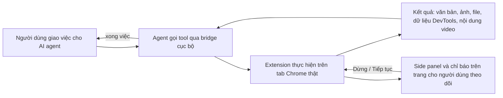
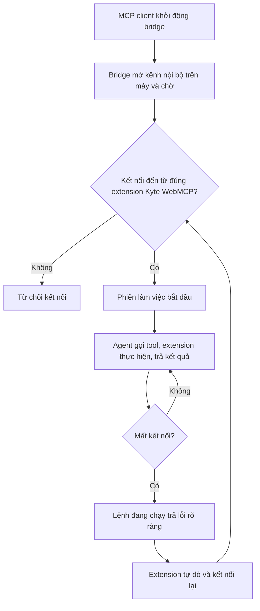
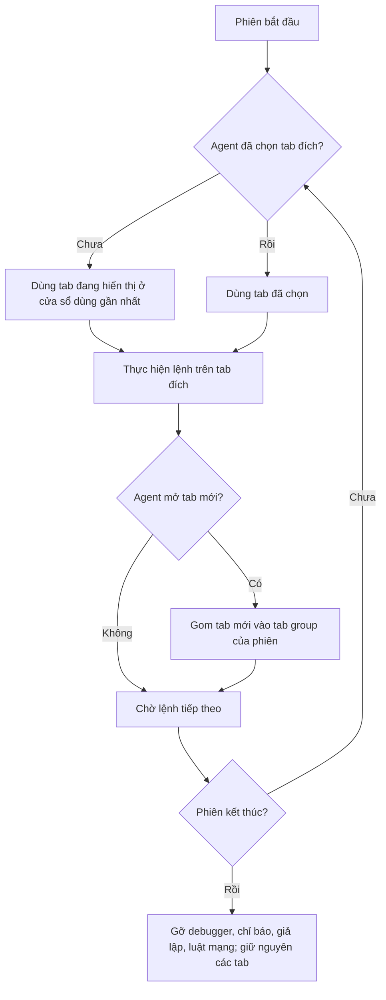
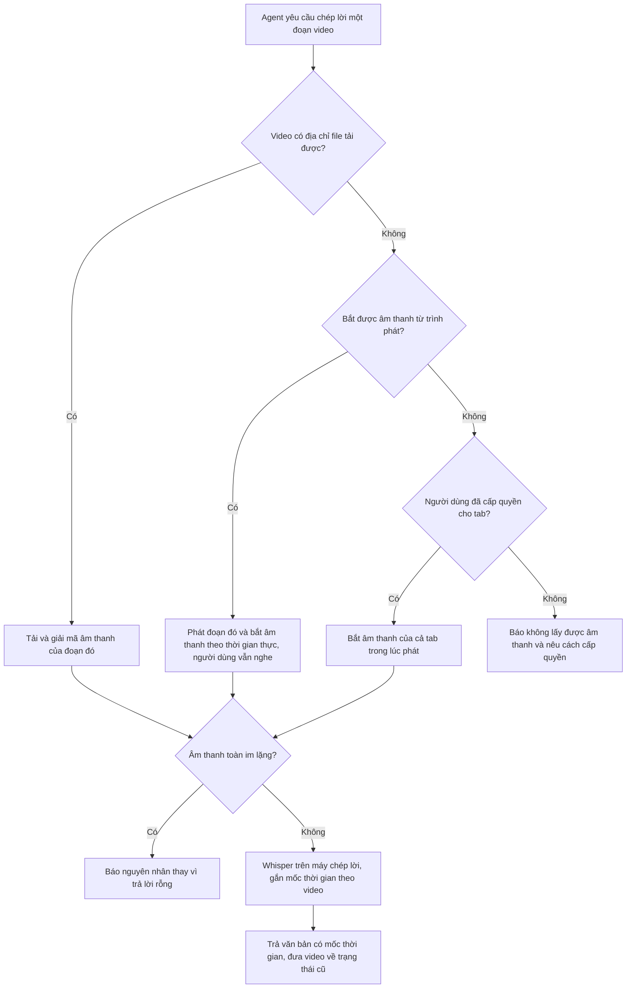
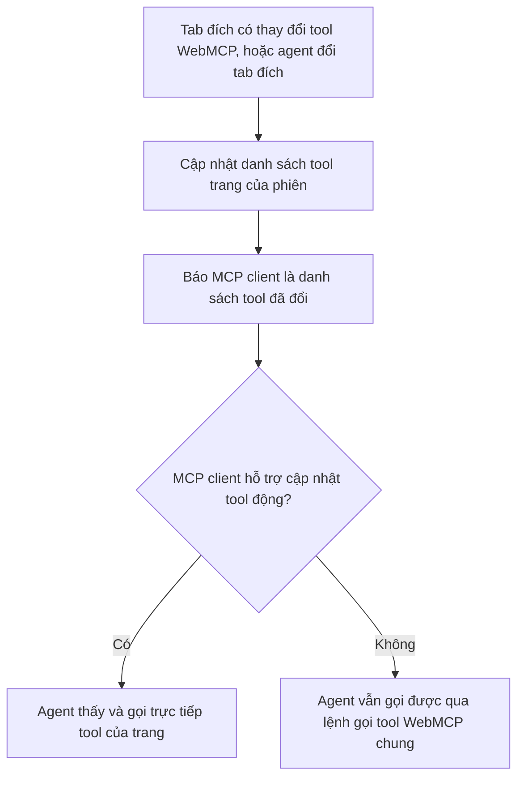
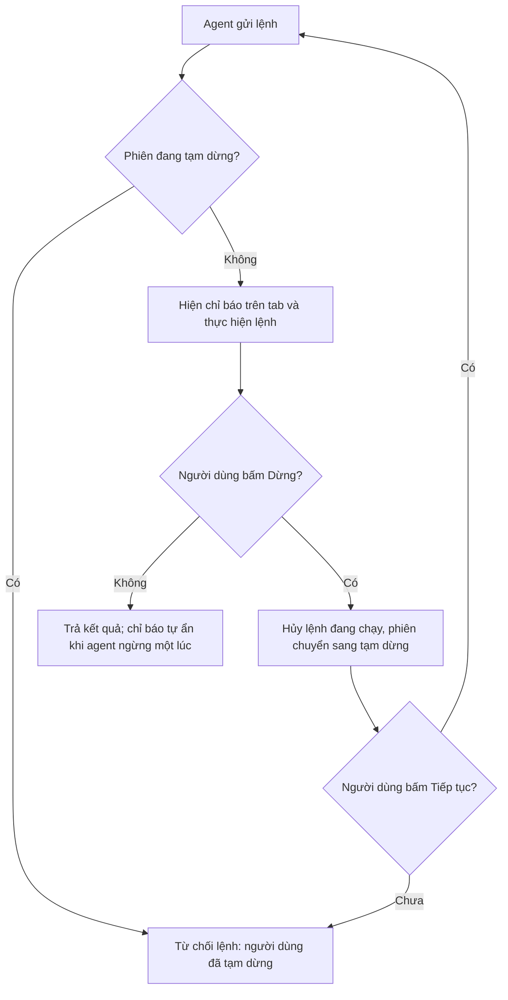
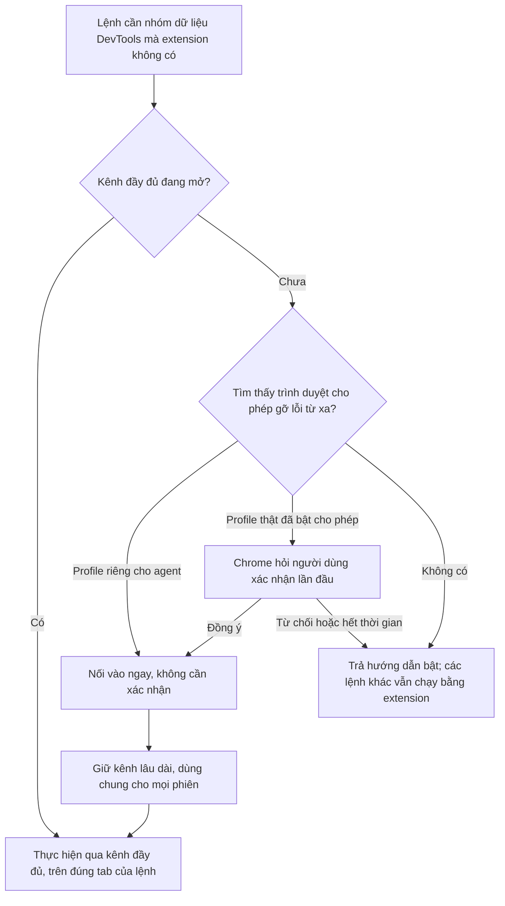

# BRD — Kyte WebMCP Extension
<!--
## HƯỚNG DẪN ĐỌC (cho AI)
- Đọc section 1 → hiểu mục tiêu, KHÔNG implement
- Đọc 2.1 Scope → xác định module cần pending
- Chỉ đọc sâu feature có trạng thái "thực hiện"
- Bỏ qua feature "pending" — chỉ đọc nếu feature đang làm có liên kết
- Lưu ý = constraint cứng, không được bỏ qua vì bất kỳ lý do kỹ thuật nào; constraint bất khả thi → dừng và báo
- Mọi quyết định tech → kiểm tra section 3 trước
- Không implement thứ BRD không mô tả; không tự mở rộng scope khi chưa được người dùng cho phép
- Mâu thuẫn giữa code hiện có và BRD → dừng và hỏi, không tự chọn bên
- Thay đổi hành vi nghiệp vụ → cập nhật BRD trong cùng thay đổi đó

## HƯỚNG DẪN CẬP NHẬT BRD (cho AI)
- CHỈ mô tả NGHIỆP VỤ: hệ thống/người dùng làm gì, luật, hành vi & kết quả mong đợi, điều kiện, ràng buộc.
  KHÔNG ghi tên file, class/component, hàm/method, biến/field, chữ ký hàm, hằng số kỹ thuật, API framework.
- KHÔNG bịa yêu cầu. Chỗ chưa rõ → hỏi người dùng hoặc ghi <TODO: cần xác nhận>.
- Mọi flow BẮT BUỘC vẽ bằng mermaid, kể cả flow tổng quan. Không mũi tên ASCII, không danh sách bước thay sơ đồ.
  Nhãn node trong mermaid cũng chỉ ghi nghiệp vụ (hành vi/quyết định), không phải tên hàm/module code.
- Sub-feature: thêm .N sau số của feature cha (2.2.X → 2.2.X.1), dùng cùng bộ field, bỏ Trạng thái/Module nếu thừa.
- KHÔNG đánh số lại feature đã có — số hiệu là địa chỉ tham chiếu chéo.
-->

# 1. Business
## 1.1. Mô tả ngắn gọn
Kyte WebMCP Extension (gọi tắt Kyte WebMCP) là một MCP server được đóng gói thành extension Chrome. Nó cho các AI agent (Claude Code, Claude Desktop, Cursor, VS Code và các MCP client khác) điều khiển chính trình duyệt Chrome mà người dùng đang dùng — với phiên đăng nhập, cookie và extension thật — thay vì một trình duyệt tự động hóa tách biệt. Agent làm được mọi thao tác người dùng làm trên trình duyệt, xem và hiểu được video có trên trang, và đọc được toàn bộ dữ liệu mà Chrome DevTools nhìn thấy.

Sản phẩm dành cho lập trình viên và người dùng chuyên sâu dùng AI agent để kiểm thử và gỡ lỗi web, tự động hóa thao tác trên web, và nghiên cứu nội dung (kể cả video). Người dùng cài extension và khai báo bridge trong MCP client một lần; từ đó agent làm việc trực tiếp trên Chrome, còn người dùng theo dõi và có thể dừng agent bất kỳ lúc nào từ giao diện của extension.

## 1.2. USP
- **Chrome thật, không phải trình duyệt dựng riêng**: agent làm việc trong đúng trình duyệt và đúng phiên đăng nhập của người dùng; không cần mở một Chrome riêng với cổng gỡ lỗi từ xa.
- **Hiểu video thật sự**: storyboard khung hình có mốc thời gian, phụ đề, và chép lời âm thanh bằng Whisper chạy ngay trên máy — âm thanh không rời khỏi máy.
- **Toàn bộ DevTools trong một chỗ**: Console, Network (kể cả HAR và mock), Performance, Elements, Application, Media, Issues, Memory, giả lập thiết bị, cộng lệnh DevTools Protocol thô cho mọi dữ liệu còn lại.
- **DevTools hai chiều**: người dùng chọn phần tử hay request trong DevTools rồi gửi cho agent; agent mở ngược lại phần tử hay file nguồn trong DevTools cho người dùng xem.
- **WebMCP-native**: tool mà trang web tự công bố theo chuẩn WebMCP của W3C tự xuất hiện thành tool của agent; có chấm điểm mức sẵn sàng của trang cho AI agent.

## 1.3. Monetize (để sau)

# 2. Implementation
## 2.1. Tổng quan sản phẩm (ngắn gọn)
Người dùng cài extension vào Chrome và khai báo bridge cục bộ trong MCP client. Mỗi khi MCP client khởi động, bridge chạy theo và extension tự kết nối vào. Agent gọi tool; extension thực hiện ngay trên tab Chrome (đọc trang, thao tác, xem video, đọc dữ liệu DevTools, gọi tool WebMCP của trang) rồi trả kết quả dạng văn bản, hình ảnh hoặc file. Trong lúc đó người dùng theo dõi qua side panel và chỉ báo trên trang, và có thể dừng agent bất kỳ lúc nào.

### Tổng quan flow

### Scope
<!-- AI: đây là danh sách module -->
| Module | Mô tả | Trạng thái |
|--------|-------|------------|
| ket-noi | Kết nối MCP client với Chrome qua bridge cục bộ; phiên làm việc của từng client; prompt mẫu cho các workflow | done |
| dieu-khien | Tab, cửa sổ, điều hướng; đọc hiểu trang; thao tác chuột/phím/form; chụp màn hình; chạy JavaScript; tải xuống, lịch sử, bookmark, clipboard, in PDF | done |
| video | Xem và hiểu video trên trang: liệt kê, điều khiển phát, khung hình, storyboard, phụ đề, chép lời, xem một đoạn, thông tin media; quay tab thành video (để sau) | thực hiện |
| devtools | Đọc và điều khiển dữ liệu DevTools: Console, Network, Performance, Elements, Application, giả lập, Issues, Memory, lệnh DevTools Protocol thô | done |
| devtools-panel | Tương tác hai chiều với giao diện DevTools của người dùng | done |
| webmcp | Phát hiện, gọi và tự công bố tool WebMCP của trang; chấm điểm mức sẵn sàng cho agent | done |
| giao-dien | Side panel của extension và chỉ báo điều khiển trên trang | done |
| hoi-nguoi-dung | Agent dừng lại hỏi người dùng giữa chừng | pending |

### MVP Content
| Loại | Số lượng | Chi tiết |
|------|----------|----------|
| Prompt mẫu (workflow) | 5 | Gỡ lỗi trang, kiểm tra hiệu năng, xem và tóm tắt video, kiểm thử tool WebMCP, chấm điểm sẵn sàng cho agent |
| Model chép lời | 1 mặc định | Whisper đa ngôn ngữ cỡ nhỏ, tải về ở lần dùng đầu (model mặc định khoảng 76MB) |
| Ngôn ngữ giao diện | 2 | Tiếng Anh và tiếng Việt, tự chọn theo ngôn ngữ của Chrome; Chrome dùng ngôn ngữ khác thì hiển thị tiếng Anh |

## 2.2. Chi tiết sản phẩm
<!-- AI: chỉ đọc feature "thực hiện", skip phần còn lại; đọc thêm "done"/"pending" nếu có liên kết -->

### 2.2.0. Feature 0: Kết nối MCP client với Chrome
- **Trạng thái**: done
- **Module**: ket-noi
- **Mô tả**: MCP client khởi chạy bridge cục bộ như một MCP server thông thường. Bridge mở một kênh nội bộ trên máy và chờ extension kết nối. Extension liên tục dò tìm các bridge đang chạy trên máy và tự kết nối; tự kết nối lại khi mất kết nối hoặc khi Chrome, extension hay MCP client khởi động lại. Nhiều MCP client chạy cùng lúc được: mỗi client có bridge riêng và extension giữ kết nối với tất cả. Bridge luôn liệt kê đầy đủ tool kể cả khi extension chưa kết nối. Khi agent gọi tool lúc chưa có kết nối, bridge chờ một khoảng ngắn để extension kịp nối vào; quá thời gian thì trả lỗi kèm hướng dẫn kiểm tra (Chrome đã mở chưa, extension đã bật chưa). Agent luôn có một tool cho biết tình trạng kết nối, phiên bản extension và phiên bản trình duyệt.
- **Flow**:

- **Lưu ý**: <!-- constraint cứng — không được bỏ qua -->
  - Kênh giữa bridge và extension chỉ lắng nghe trên địa chỉ loopback của máy, không mở ra mạng.
  - Bridge từ chối mọi kết nối không đến từ extension Kyte WebMCP, kể cả kết nối từ trang web đang mở trong trình duyệt.
  - Mất kết nối giữa chừng thì lệnh đang chạy phải kết thúc bằng lỗi rõ ràng, không treo agent.
  - Danh sách tool agent nhìn thấy không phụ thuộc việc extension đã kết nối hay chưa.

---

### 2.2.1. Feature 1: Phiên làm việc của agent
- **Trạng thái**: done
- **Module**: ket-noi
- **Mô tả**: Mỗi MCP client đang kết nối là một phiên, mang tên của client (vd "claude-code"). Chế độ điều khiển là **tự động hoàn toàn**: agent không cần xin phép và được điều khiển mọi tab, kể cả tab người dùng đang mở. Khi agent chưa chọn tab, tab đích mặc định là tab đang hiển thị ở cửa sổ người dùng dùng gần nhất. Tab do agent mở mới được gom vào một tab group riêng của phiên, đặt tên theo client, để người dùng phân biệt với tab của mình. Agent chọn tab đích bằng cách chỉ định tab cho từng lệnh, hoặc chọn một tab làm mặc định cho các lệnh sau. Khi phiên kết thúc (client đóng hoặc mất kết nối), mọi thứ phiên đã đặt lên trình duyệt được gỡ: gỡ gắn debugger, tắt chỉ báo, gỡ giả lập và luật can thiệp mạng; các tab vẫn được giữ nguyên.
- **Flow**:

- **Lưu ý**: <!-- constraint cứng — không được bỏ qua -->
  - Sau khi phiên kết thúc, không còn tab nào bị extension gắn debugger vì phiên đó.
  - Giả lập thiết bị/mạng/CPU và luật can thiệp mạng do phiên đặt đều bị gỡ khi phiên kết thúc.
  - Phiên kết thúc không được đóng tab nào.
  - Tab do agent mở mới luôn nằm trong tab group của phiên đã mở nó.

---

### 2.2.2. Feature 2: Tab, cửa sổ và điều hướng
- **Trạng thái**: done
- **Module**: dieu-khien
- **Mô tả**: Agent liệt kê mọi tab ở mọi cửa sổ (tiêu đề, địa chỉ, đang hiển thị hay không, đang phát âm thanh, thuộc phiên nào), mở tab mới, chọn tab làm đích, kích hoạt tab, đóng tab. Tab do agent mở được theo dõi ngay từ trước khi trang tải, nên dữ liệu Console và Network có cả lần tải đầu; mở tab mà trang tải thất bại thì báo lỗi. Agent điều hướng tab tới một địa chỉ, lùi, tiến, tải lại; mặc định chờ trang tải xong rồi mới trả kết quả, kèm địa chỉ cuối cùng (sau chuyển hướng), tiêu đề và mã trạng thái HTTP. Agent chờ một điều kiện trên trang: chữ xuất hiện hoặc biến mất, phần tử xuất hiện, mạng rảnh, hoặc chờ một khoảng thời gian; quá thời hạn thì báo hết thời gian.
- **Lưu ý**: <!-- constraint cứng — không được bỏ qua -->
  - Điều hướng thất bại (lỗi mạng, địa chỉ sai) phải trả lỗi mô tả nguyên nhân, không được trả thành công.
  - Mọi lệnh chờ đều có thời hạn; không lệnh nào chờ vô hạn.

---

### 2.2.3. Feature 3: Đọc hiểu trang
- **Trạng thái**: done
- **Module**: dieu-khien
- **Mô tả**: Agent lấy cấu trúc trang dạng cây truy cập (accessibility tree) rút gọn: mỗi nút có vai trò, tên, trạng thái (đang chọn, bị vô hiệu, mở rộng, giá trị ô nhập…), và mỗi phần tử tương tác được có một mã tham chiếu ngắn để dùng cho các lệnh thao tác. Cây bao gồm nội dung trong iframe (cả khác origin) và shadow DOM. Agent có thể giới hạn chỉ lấy phần tử tương tác được, chỉ lấy phần đang nằm trong khung nhìn, hoặc chỉ lấy một nhánh con. Agent đọc nội dung chữ của trang hoặc của một phần tử dưới dạng Markdown (tiêu đề, đoạn, danh sách, liên kết, bảng), có phân trang khi dài. Agent tìm phần tử theo chữ, theo CSS selector hoặc XPath và nhận lại mã tham chiếu. Agent xem thông tin chung của trang: địa chỉ, tiêu đề, trạng thái tải, ngôn ngữ, kích thước khung nhìn, vị trí cuộn, cây frame.
- **Lưu ý**: <!-- constraint cứng — không được bỏ qua -->
  - Một phần tử còn tồn tại trên trang giữ nguyên mã tham chiếu giữa các lần lấy cấu trúc.
  - Dùng mã tham chiếu của phần tử đã mất (trang thay đổi, đã điều hướng) phải báo lỗi mã hết hiệu lực, không được thao tác lên phần tử khác.
  - Kết quả dài phải được cắt kèm cách lấy phần tiếp theo, không trả một khối vượt giới hạn hiển thị của MCP client.

---

### 2.2.4. Feature 4: Thao tác như người dùng
- **Trạng thái**: done
- **Module**: dieu-khien
- **Mô tả**: Agent click (chuột trái/phải/giữa, nhấp đúp, kèm phím bổ trợ) vào phần tử theo mã tham chiếu hoặc theo tọa độ; rê chuột; gõ chữ vào ô nhập từng phím như người dùng thật (có thể xóa nội dung cũ trước và nhấn Enter sau; đoạn dài hơn 200 ký tự được dán một lần cho nhanh; xuống dòng được chèn như chữ chứ không phải phím Enter, để không vô tình gửi form); nhấn phím và tổ hợp phím; điền nhiều trường form trong một lệnh (ô chữ, checkbox, radio, danh sách chọn); chọn mục trong danh sách chọn; cuộn trang hoặc cuộn tới phần tử; kéo thả (cả kéo thả HTML5); đính kèm file vào ô tải lên; chấp nhận hoặc từ chối hộp thoại của trang (alert/confirm/prompt). Phần tử nằm ngoài khung nhìn được tự cuộn vào trước khi thao tác. Tab đích đang ở nền (người dùng xem tab khác) vẫn thao tác được mà không bị đưa lên trước; riêng cuộn theo khoảng cách thì Chrome không xử lý con lăn chuột ở tab nền, nên hệ thống cuộn trực tiếp và nói rõ điều đó trong kết quả. Sau mỗi thao tác agent nhận bản tóm tắt thay đổi: trang có chuyển địa chỉ không, có mở tab mới không, có hộp thoại nào đang mở không, có lỗi console mới không.
- **Lưu ý**: <!-- constraint cứng — không được bỏ qua -->
  - Sự kiện chuột và bàn phím phải đến trang như sự kiện tin cậy của người dùng thật.
  - Khi trang đang mở hộp thoại chặn, lệnh thao tác phải báo ngay có hộp thoại đang mở thay vì treo.

---

### 2.2.5. Feature 5: Chụp màn hình
- **Trạng thái**: done
- **Module**: dieu-khien
- **Mô tả**: Agent chụp khung nhìn hiện tại, toàn bộ trang (kể cả phần phải cuộn) hoặc riêng một phần tử. Agent có thể yêu cầu đánh dấu số (Set-of-Mark): vẽ khung và nhãn mã tham chiếu lên các phần tử tương tác để mô hình nhìn ảnh rồi chỉ định phần tử. Ảnh được thu nhỏ theo kích thước tối đa agent yêu cầu để tiết kiệm token; có thể lưu ra file thay vì trả ảnh.
- **Lưu ý**: <!-- constraint cứng — không được bỏ qua -->
  - Chỉ báo điều khiển của extension không được xuất hiện trong ảnh chụp.
  - Đánh dấu số chỉ vẽ lên ảnh, không thay đổi trang.

---

### 2.2.6. Feature 6: JavaScript và tiện ích trình duyệt
- **Trạng thái**: done
- **Module**: dieu-khien
- **Mô tả**: Agent chạy một đoạn JavaScript trong ngữ cảnh trang (kể cả trong một iframe cụ thể) và nhận kết quả dạng JSON; lỗi ném ra được trả kèm thông báo và vị trí. Agent quản lý tải xuống (tải một địa chỉ, liệt kê, chờ tải xong), tìm trong lịch sử duyệt web, tìm/tạo/xóa bookmark, đọc và ghi clipboard, và in trang ra file PDF.
- **Lưu ý**: <!-- constraint cứng — không được bỏ qua -->
  - Kết quả JavaScript không chuyển được sang JSON (vd phần tử DOM, hàm) phải được mô tả lại thay vì làm lỗi lệnh.

---

### 2.2.7. Feature 7: Liệt kê và điều khiển video
- **Trạng thái**: done
- **Module**: video
- **Mô tả**: Agent liệt kê mọi video/audio trên trang, kể cả trong iframe và shadow DOM: nguồn, thời lượng, vị trí đang phát, đang phát hay dừng, âm lượng và tắt tiếng, tốc độ, kích thước khung hình, có phải livestream không, có được bảo vệ bản quyền (DRM) không, các track phụ đề có sẵn, và nền tảng nhận diện được (vd YouTube). Agent điều khiển: phát, dừng, tua tới thời điểm, đổi tốc độ, tắt/bật tiếng, đổi âm lượng.
- **Lưu ý**: <!-- constraint cứng — không được bỏ qua -->
  - Lệnh phát phải chạy được cả khi trang chỉ cho phát sau khi người dùng tương tác.

---

### 2.2.8. Feature 8: Khung hình và storyboard
- **Trạng thái**: done
- **Module**: video
- **Mô tả**: Agent lấy khung hình hiện tại hoặc khung hình tại các thời điểm chỉ định. Agent tạo storyboard: lấy N khung hình rải đều trong một khoảng thời gian, ghép thành một ảnh lưới, mỗi ô ghi mốc thời gian, kèm danh sách mốc thời gian — để mô hình "xem" cả đoạn video trong một ảnh. Video livestream hoặc không tua được thì lấy khung hình trong lúc video đang phát. Video chặn đọc điểm ảnh (nguồn khác origin, hoặc được bảo vệ bản quyền) vẫn lấy được khung hình bằng cách chụp vùng video đang hiển thị; chỉ khi chính hình hiển thị cũng bị che đen thì mới coi là bị DRM chặn.
- **Lưu ý**: <!-- constraint cứng — không được bỏ qua -->
  - Sau khi lấy khung hình bằng cách tua, video trở lại đúng vị trí phát và đúng trạng thái phát/dừng như trước.
  - Khung hình đen do DRM chặn phải được báo rõ là bị DRM chặn, không trả như kết quả bình thường.

---

### 2.2.9. Feature 9: Phụ đề video
- **Trạng thái**: done
- **Module**: video
- **Mô tả**: Agent lấy phụ đề có mốc thời gian của video, theo thứ tự ưu tiên: track phụ đề của trình phát HTML5; phụ đề của YouTube; phụ đề mà trình phát tải về qua mạng (bắt từ dữ liệu Network). Agent chọn ngôn ngữ khi có nhiều track và có thể giới hạn khoảng thời gian.
- **Lưu ý**: <!-- constraint cứng — không được bỏ qua -->
  - Không có nguồn phụ đề nào thì báo rõ là không có phụ đề và gợi ý dùng chép lời (2.2.10), không trả kết quả rỗng như thành công.

---

### 2.2.10. Feature 10: Chép lời âm thanh bằng Whisper local
- **Trạng thái**: done
- **Module**: video
- **Mô tả**: Với video không có phụ đề, agent yêu cầu chép lời một đoạn âm thanh. Hệ thống tự chọn cách lấy âm thanh phù hợp: tải và giải mã trực tiếp file media khi video có địa chỉ file; nếu không (vd trình phát dạng stream như YouTube) thì bắt âm thanh trong lúc phát đoạn đó theo thời gian thực; hoặc bắt âm thanh của cả tab khi người dùng đã cấp quyền cho tab đó bằng cách bấm vào extension. Âm thanh được chép lời bằng Whisper chạy ngay trên máy, trả về văn bản có mốc thời gian tính theo thời gian của video. Lần đầu dùng, model được tải về và lưu cache; các lần sau dùng lại. Agent có thể chọn ngôn ngữ hoặc để tự nhận diện.
- **Flow**:

- **Lưu ý**: <!-- constraint cứng — không được bỏ qua -->
  - Âm thanh không được gửi ra khỏi máy người dùng.
  - Trong khi bắt âm thanh theo thời gian thực, người dùng vẫn nghe được âm thanh của video.
  - Âm thanh bắt được toàn im lặng thì phải báo nguyên nhân, không trả lời rỗng như thành công.
  - Chép lời xong, video trở lại vị trí và trạng thái phát/dừng như trước.

---

### 2.2.11. Feature 11: Xem một đoạn video
- **Trạng thái**: done
- **Module**: video
- **Mô tả**: Agent yêu cầu "xem" một đoạn video và nhận trong một lần gọi: thông tin video, storyboard của đoạn đó, và lời thoại của đoạn (ưu tiên phụ đề, không có thì chép lời bằng Whisper), sắp theo dòng thời gian. Đây là cách nhanh để agent hiểu nội dung một video.
- **Lưu ý**: <!-- constraint cứng — không được bỏ qua -->
  - Kết quả luôn nói rõ lời thoại lấy từ phụ đề hay từ chép lời.

---

### 2.2.12. Feature 12: Thông tin media
- **Trạng thái**: done
- **Module**: video
- **Mô tả**: Agent đọc thông tin trình phát như bảng Media của DevTools: codec, độ phân giải, tốc độ khung hình, bitrate, số khung hình bị rơi, trạng thái bộ đệm, sự kiện và lỗi phát. Phần quay tab thành video được tách ra feature 2.2.29 (để sau).

---

### 2.2.13. Feature 13: Console
- **Trạng thái**: done
- **Module**: devtools
- **Mô tả**: Agent đọc log console của tab như bảng Console: mức độ (log/info/warn/error/debug), nội dung, vị trí nguồn, thời điểm, stack trace, lỗi chưa bắt, và log phía trình duyệt (lỗi mạng, vi phạm chính sách, cảnh báo). Agent lọc theo mức độ, theo chữ hoặc biểu thức chính quy, theo mốc thời gian, và xóa bộ đệm log. Log phát sinh trước khi agent bắt đầu theo dõi tab được lấy lại trong phạm vi Chrome còn giữ.
- **Lưu ý**: <!-- constraint cứng — không được bỏ qua -->
  - Bộ đệm log của mỗi tab có giới hạn; khi đầy thì bỏ log cũ nhất, bộ nhớ không tăng vô hạn.

---

### 2.2.14. Feature 14: Network
- **Trạng thái**: done
- **Module**: devtools
- **Mô tả**: Agent liệt kê request của tab như bảng Network (phương thức, địa chỉ, mã trạng thái, loại tài nguyên, kích thước, thời gian, lấy từ cache hay không, nguyên nhân khởi tạo) và lọc theo địa chỉ, loại, phương thức, mã trạng thái, hoặc chỉ request lỗi. Agent xem chi tiết một request: header gửi và nhận, dữ liệu gửi đi, nội dung phản hồi, phân rã thời gian, thông tin bảo mật, các khung WebSocket. Agent xuất toàn bộ request thành file HAR. Agent đặt luật can thiệp mạng để kiểm thử tình huống lỗi: chặn request, trả phản hồi giả (mã, header, nội dung), sửa header; xem và gỡ luật.
- **Lưu ý**: <!-- constraint cứng — không được bỏ qua -->
  - Luật can thiệp mạng chỉ áp dụng cho tab được chỉ định và bị gỡ khi phiên kết thúc.
  - Nội dung phản hồi nhị phân hoặc quá lớn được lưu ra file thay vì trả thẳng vào kết quả.
  - Bộ đệm request của mỗi tab có giới hạn; khi đầy thì bỏ request cũ nhất.

---

### 2.2.15. Feature 15: Performance
- **Trạng thái**: done
- **Module**: devtools
- **Mô tả**: Agent đo Core Web Vitals của trang (LCP kèm phần tử, CLS kèm nguồn dịch chuyển, INP, FCP, TTFB) và chỉ số runtime (bộ nhớ JS, số node DOM, số lần layout, thời gian chạy script). Agent ghi trace hiệu năng (có thể tải lại trang lúc bắt đầu), lưu file trace mở được bằng bảng Performance của DevTools, và nhận bản phân tích tóm tắt: tác vụ dài, tổng thời gian chặn, phân bổ thời gian luồng chính, tài nguyên chặn hiển thị, LCP và CLS. Agent đo độ phủ mã (Coverage) CSS/JS: tỉ lệ mã không dùng theo từng file.
- **Lưu ý**: <!-- constraint cứng — không được bỏ qua -->
  - File trace phải mở được trong bảng Performance của Chrome DevTools.

---

### 2.2.16. Feature 16: Elements (DOM và CSS)
- **Trạng thái**: done
- **Module**: devtools
- **Mô tả**: Với một phần tử, agent xem như bảng Elements: HTML, thuộc tính, box model, style đã tính, các luật CSS khớp kèm file nguồn và dòng, event listener gắn trên phần tử, và thuộc tính truy cập (vai trò, tên, trạng thái).

---

### 2.2.17. Feature 17: Application (lưu trữ và bảo mật)
- **Trạng thái**: done
- **Module**: devtools
- **Mô tả**: Agent đọc, ghi, xóa cookie (kể cả cookie HttpOnly); đọc, ghi, xóa localStorage và sessionStorage của trang; xem IndexedDB (cơ sở dữ liệu, object store, bản ghi), Cache Storage, service worker, manifest web app, dung lượng lưu trữ, trạng thái bảo mật và chứng chỉ của trang.

---

### 2.2.18. Feature 18: Giả lập
- **Trạng thái**: done
- **Module**: devtools
- **Mô tả**: Agent giả lập thiết bị (kích thước, tỉ lệ điểm ảnh, di động, cảm ứng; có sẵn một số mẫu thiết bị phổ biến), user agent, ngôn ngữ, múi giờ, vị trí địa lý, chế độ sáng/tối, giảm chuyển động, tình trạng mạng (offline, 3G chậm, 3G nhanh, 4G, tùy chỉnh), giảm tốc CPU, mô phỏng khiếm khuyết thị giác; và gỡ toàn bộ giả lập.
- **Lưu ý**: <!-- constraint cứng — không được bỏ qua -->
  - Gỡ giả lập đưa tab về đúng trạng thái trước khi giả lập.

---

### 2.2.19. Feature 19: Issues và Memory
- **Trạng thái**: done
- **Module**: devtools
- **Mô tả**: Agent đọc các vấn đề mà bảng Issues của DevTools phát hiện (CORS, nội dung hỗn hợp, cookie, API lỗi thời…). Agent đọc bộ đếm bộ nhớ (node DOM, event listener, document) và chụp heap snapshot lưu ra file mở được bằng bảng Memory của DevTools.

---

### 2.2.20. Feature 20: Lệnh DevTools Protocol thô
- **Trạng thái**: done
- **Module**: devtools
- **Mô tả**: Để đọc mọi dữ liệu DevTools mà các tool chuyên biệt chưa bao quát, agent gửi bất kỳ lệnh DevTools Protocol nào tới tab (hoặc tới iframe/worker con của tab) và nhận kết quả; agent đăng ký nhận sự kiện của bất kỳ domain nào và đọc các sự kiện đã thu được.
- **Lưu ý**: <!-- constraint cứng — không được bỏ qua -->
  - Lệnh thô tắt một domain mà các tool khác đang dùng không được làm các tool đó ngừng hoạt động.

---

### 2.2.21. Feature 21: DevTools hai chiều
- **Trạng thái**: done
- **Module**: devtools-panel
- **Mô tả**: Khi người dùng mở DevTools trên một tab, extension có một panel riêng trong DevTools. Phần tử người dùng đang chọn trong bảng Elements luôn được cung cấp cho agent (selector, HTML rút gọn, mã tham chiếu). Trong panel, người dùng gửi phần tử đang chọn hoặc một request trong danh sách request cho agent, kèm ghi chú; agent đọc được các mục đã gửi. Ngược lại, agent mở cho người dùng xem một phần tử trong bảng Elements, hoặc một file nguồn tại dòng chỉ định trong bảng Sources. Panel hiển thị trạng thái kết nối của agent với tab đó và các hành động agent vừa làm trên tab.
- **Giao diện**:
  - Panel "Kyte WebMCP" trong DevTools: trạng thái agent trên tab, phần tử đang chọn, ô ghi chú và nút gửi cho agent, danh sách request gần đây có nút gửi, nhật ký hành động của agent trên tab.
- **Lưu ý**: <!-- constraint cứng — không được bỏ qua -->
  - Mở phần tử/file trong DevTools chỉ hoạt động khi DevTools đang mở trên tab đó; nếu không, agent nhận lỗi hướng dẫn người dùng mở DevTools.

---

### 2.2.22. Feature 22: Phát hiện và gọi tool WebMCP của trang
- **Trạng thái**: done
- **Module**: webmcp
- **Mô tả**: Agent liệt kê các tool mà trang công bố theo chuẩn WebMCP (cả dạng đăng ký bằng script lẫn dạng form khai báo, trong mọi frame): tên, mô tả, lược đồ tham số, các cờ (chỉ đọc, có hệ quả lớn, nội dung không tin cậy). Agent gọi một tool với tham số và nhận kết quả. Dùng được với trang tham gia origin trial WebMCP, hoặc khi người dùng đã bật cờ WebMCP trong Chrome.
- **Lưu ý**: <!-- constraint cứng — không được bỏ qua -->
  - Kết quả từ tool WebMCP luôn được đánh dấu là dữ liệu không tin cậy đến từ trang web.
  - Khi Chrome hoặc trang chưa hỗ trợ WebMCP, agent nhận lý do và cách bật, không nhận danh sách rỗng như thể trang không có tool.

---

### 2.2.23. Feature 23: Tự công bố tool WebMCP thành tool của agent
- **Trạng thái**: done
- **Module**: webmcp
- **Mô tả**: Tool WebMCP của tab đích hiện tại tự xuất hiện thành tool riêng trong danh sách tool của agent (có tiền tố để phân biệt), và tự cập nhật khi trang thêm hay bớt tool hoặc khi agent đổi tab đích. Agent gọi trực tiếp các tool này như tool thường.
- **Flow**:

- **Lưu ý**: <!-- constraint cứng — không được bỏ qua -->
  - Tên tool được công bố không bao giờ trùng tên tool sẵn có của Kyte WebMCP.
  - MCP client không hỗ trợ cập nhật tool động vẫn gọi được tool của trang qua lệnh gọi tool WebMCP chung (2.2.22).

---

### 2.2.24. Feature 24: Chấm điểm sẵn sàng cho agent
- **Trạng thái**: done
- **Module**: webmcp
- **Mô tả**: Agent chấm điểm mức một trang sẵn sàng cho AI agent theo các tiêu chí của hạng mục "Agentic Browsing" mà Lighthouse công bố: chất lượng cây truy cập (phần tử tương tác có tên, ảnh có mô tả, form có nhãn, có landmark), độ ổn định bố cục (CLS), có tool WebMCP và chất lượng mô tả/lược đồ của chúng, có file llms.txt. Kết quả gồm điểm từng tiêu chí, các phát hiện cụ thể và gợi ý sửa.
- **Lưu ý**: <!-- constraint cứng — không được bỏ qua -->
  - Thiếu file llms.txt không bị trừ điểm (giống cách Lighthouse đánh giá là không áp dụng).

---

### 2.2.25. Feature 25: Side panel
- **Trạng thái**: done
- **Module**: giao-dien
- **Mô tả**: Bấm vào biểu tượng extension để mở side panel. Side panel hiển thị trạng thái kết nối (đang chờ MCP client, hoặc số phiên đang kết nối) và hướng dẫn cấu hình MCP client có nút sao chép; danh sách phiên (tên client, tab group, tab đích, số lệnh đã chạy) với nút Dừng/Tiếp tục cho từng phiên và nút Dừng tất cả; nhật ký hoạt động trực tiếp của các lệnh agent (thời gian, tên lệnh, tóm tắt tham số, thời lượng, thành công/lỗi), có lọc và xem chi tiết; tool WebMCP của tab hiện tại; cài đặt (bật/tắt chỉ báo trên trang, chọn model chép lời).
- **Giao diện**:
  - Phong cách giống phần Cài đặt hệ thống (System Settings) của macOS, theo chế độ sáng/tối của máy: các mục là nhóm bo góc có tiêu đề phía trên, công tắc và nút kiểu macOS. Panel trong DevTools và chỉ báo trên trang dùng cùng phong cách; icon extension là chữ K trên nền xanh bo góc kiểu icon ứng dụng macOS.
  - Phần đầu: trạng thái kết nối và nút Dừng tất cả.
  - Các mục: Phiên, Nhật ký hoạt động, WebMCP của tab hiện tại, Cài đặt, Hướng dẫn kết nối.
- **Lưu ý**: <!-- constraint cứng — không được bỏ qua -->
  - Trạng thái trên side panel tự cập nhật, người dùng không phải tải lại side panel.
  - Nhật ký hoạt động không mất khi Chrome tự dừng rồi khởi động lại extension lúc rảnh; nhật ký chỉ mất khi đóng Chrome.

---

### 2.2.26. Feature 26: Chỉ báo điều khiển và nút Dừng
- **Trạng thái**: done
- **Module**: giao-dien
- **Mô tả**: Khi agent đang thao tác trên một tab, tab đó có viền sáng quanh trang và một nhãn nhỏ cho biết agent đang điều khiển, kèm nút Dừng; chỉ báo tự ẩn sau khi agent ngừng hoạt động một lúc. Bấm Dừng (trên trang hoặc ở side panel) thì lệnh đang chạy của phiên bị hủy và phiên chuyển sang trạng thái tạm dừng: mọi lệnh tiếp theo bị từ chối với thông báo người dùng đã tạm dừng, cho tới khi người dùng bấm Tiếp tục. Biểu tượng extension hiển thị trạng thái đã kết nối hoặc tạm dừng.
- **Flow**:

- **Lưu ý**: <!-- constraint cứng — không được bỏ qua -->
  - Chỉ báo không được chặn thao tác chuột của người dùng lên trang, ngoài chính nút Dừng.
  - Chỉ báo không được làm thay đổi bố cục hay style của trang.
  - Chỉ báo không xuất hiện trong cây truy cập mà agent đọc.
  - Ở trạng thái tạm dừng, không lệnh nào của phiên đó được thực hiện lên trình duyệt.

---

### 2.2.27. Feature 27: Hỏi người dùng giữa chừng
- **Trạng thái**: pending
- **Module**: hoi-nguoi-dung
- **Mô tả**: Khi gặp bước chỉ người dùng làm được (mã 2FA, CAPTCHA, đăng nhập, lựa chọn cá nhân), agent hiển thị một yêu cầu ngay trên trang và trên side panel: câu hỏi, có thể kèm ô nhập hoặc các lựa chọn, và nút Xong/Hủy. Agent chờ tới khi người dùng trả lời hoặc hết thời hạn, rồi tiếp tục với câu trả lời.
- **Lưu ý**: <!-- constraint cứng — không được bỏ qua -->
  - Hết thời hạn mà người dùng chưa trả lời thì agent nhận kết quả hết thời gian, không treo.
  - Câu trả lời của người dùng chỉ được trả cho đúng phiên đã hỏi.

---

### 2.2.28. Feature 28: Prompt mẫu cho workflow
- **Trạng thái**: done
- **Module**: ket-noi
- **Mô tả**: Bridge cung cấp các prompt mẫu mà MCP client hiển thị như lệnh nhanh: gỡ lỗi trang hiện tại, kiểm tra hiệu năng, xem và tóm tắt video, kiểm thử tool WebMCP của trang, chấm điểm sẵn sàng cho agent. Mỗi prompt hướng dẫn agent chuỗi tool phù hợp cho việc đó.

---

### 2.2.30. Feature 30: Kênh DevTools đầy đủ
- **Trạng thái**: done
- **Module**: devtools
- **Mô tả**: Chrome chỉ cho extension dùng một phần các nhóm dữ liệu DevTools; các nhóm còn lại (độ phủ mã JavaScript, heap snapshot, bảng Media, Memory, IndexedDB, Service Worker, Security, Animation, Preload…) chỉ mở cho kết nối gỡ lỗi từ xa của chính Chrome. Người dùng muốn có DevTools đầy đủ mà không phải thao tác mỗi lần, nên hệ thống có thêm một kênh DevTools đầy đủ, dùng tự động khi một lệnh cần nhóm dữ liệu mà extension không có. Kênh này kết nối tới đúng trình duyệt đang chạy extension theo một trong hai cách: với profile riêng cho agent do Kyte WebMCP khởi chạy thì kết nối không cần người dùng xác nhận lần nào; với profile thật của người dùng (sau khi người dùng bật cho phép gỡ lỗi từ xa trong Chrome một lần), Chrome hỏi người dùng xác nhận khi kênh nối vào lần đầu, sau đó kênh được giữ lâu dài và dùng chung cho mọi phiên agent nên không hỏi lại cho tới khi Chrome khởi động lại. Khi kênh chưa sẵn sàng, các lệnh cần nó trả lời kèm hướng dẫn bật, còn các lệnh khác vẫn chạy bằng extension.
- **Flow**:

- **Lưu ý**: <!-- constraint cứng — không được bỏ qua -->
  - Hệ thống không bao giờ tự xác nhận thay người dùng hộp thoại cho phép gỡ lỗi từ xa của Chrome.
  - Với profile thật, sau khi người dùng đồng ý một lần, các phiên agent tiếp theo không làm Chrome hỏi lại cho tới khi Chrome khởi động lại.
  - Kênh đầy đủ chỉ nhận yêu cầu từ các bridge Kyte WebMCP trên cùng máy, có xác thực; không mở ra mạng.
  - Lệnh cần kênh đầy đủ luôn chạy trên đúng tab mà agent chỉ định, không nhầm sang tab khác.

---

### 2.2.29. Feature 29: Quay tab thành video
- **Trạng thái**: pending
- **Module**: video
- **Mô tả**: Agent quay lại những gì hiển thị trên tab thành file video (bắt đầu và kết thúc theo lệnh) để lưu lại quá trình thao tác.
- **Lưu ý**: <!-- constraint cứng — không được bỏ qua -->
  - File quay được lưu ở vị trí agent chỉ định hoặc thư mục mặc định, và đường dẫn file được trả về cho agent.

---

# 3. Tech stack
- TypeScript cho cả extension và bridge.
- Extension Chrome Manifest V3, dùng Chrome DevTools Protocol qua quyền debugger của extension. Tính năng WebMCP cần Chrome có WebMCP (origin trial từ Chrome 149, hoặc bật cờ WebMCP).
- Bridge chạy trên Node.js, dùng MCP TypeScript SDK bản ổn định (spec MCP 2025-11-25); nói chuyện với MCP client qua stdio, với extension qua WebSocket trên loopback.
- Chép lời: Whisper chạy local bằng transformers.js (ONNX Runtime) trong bridge.
- Build bằng esbuild. Kiểm thử bằng Node test runner và Puppeteer điều khiển Chrome for Testing có nạp extension.
- Không dùng dịch vụ cloud nào; chỉ tải model Whisper một lần từ HuggingFace.

# 4. Yêu cầu kiểm thử trước bàn giao
Theo yêu cầu của người dùng: test toàn luồng, test giao diện, test ảnh hưởng trước khi bàn giao.
- **Toàn luồng**: MCP client thật gọi qua bridge tới extension trên Chrome thật, cho mọi nhóm tool, trên các trang kiểm thử có đủ tình huống (form, iframe khác origin, shadow DOM, hộp thoại, upload, video có/không phụ đề, tool WebMCP, lỗi console, request mạng).
- **Giao diện**: side panel, chỉ báo trên trang và panel DevTools hiển thị đúng ở các trạng thái (chưa kết nối, đã kết nối, đang chạy lệnh, tạm dừng) và thao tác được, bằng cả tiếng Anh và tiếng Việt.
- **Ảnh hưởng**: extension không làm thay đổi hành vi, giao diện hay hiệu năng của trang mà agent chưa đụng tới; sau khi phiên kết thúc mọi thứ được gỡ sạch; nhiều phiên cùng lúc không lẫn vào nhau; DevTools của người dùng vẫn dùng bình thường khi agent đang gắn debugger.
- **Lưu ý**:
  - Không bàn giao khi còn bài kiểm thử thất bại mà chưa báo rõ cho người dùng.
  - Extension không chèn script hay phần tử nào vào trang mà agent chưa từng thao tác.
